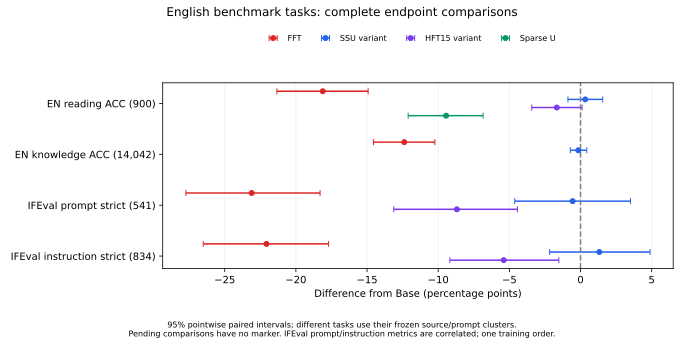

# 组会：当前完整预算基线大表

更新时间：2026-10-29 11:41:57。
已验收26/42个非暂停完整分任务。空白表示未完成；MoFO用户暂停。

|方法|SW阅读ACC|SW知识ACC|EN→SW|SW→EN|EN阅读ACC|EN知识ACC|IFEval-P strict|IFEval-I strict|GSM8K|
|---|---|---|---|---|---|---|---|---|---|
|Base|37.56|30.47|21.18|21.79|81.78|59.34|41.22|49.88||
|Dense FFT|43.33|31.66|44.29|28.18|63.67|46.95|18.11|27.82||
|SSU-token-weighted-15matched|43.56||29.42|39.46|82.11|59.18|40.67|51.20||
|HFT-whole-matrix-15matched|40.78||28.22|39.75|80.11||32.53|44.48||
|元素稀疏U|43.78||40.26|42.73|72.33|52.41|21.07|31.65||
|英语敏感度保护P||||||||||
|MoFO（暂停）||||||||||

百分比：阅读/知识ACC、IFEval strict、GSM8K strict。翻译为语料级chrF++。阅读900题/语言，知识14042题/语言，翻译1012题/方向，IFEval541提示/834指令，GSM8K1319题。
全部适配端点预算42465步、15360935输入Token、5984371监督Token、Aya80/10/10。SSU为Token加权变体，HFT15为整矩阵预算匹配变体；HFT15/SSU/U/P同名额196608000/步，分母为196个候选矩阵。
表示漂移是优先的新实验：Base/FFT/U已提取，P结束后优先提取并执行四模型统计；不等待baseline表填满。
临时六卡仅加速当前已授权任务，不启动空占进程或额外科学实验。18:00按表示漂移是否有可用结果决定后续配方；未出结果则后续实验恢复旧D2 FineWeb70/Aya10/双向翻译各10%。当前运行任务不因时限中止或改变数据。

当前取舍：U的翻译强于SSU，但EN阅读72.33%对82.11%、EN知识52.41%对59.18%、IFEval提示21.07%对40.67%。U−Base EN知识差值−6.922个百分点，95%学科配对区间[−8.129,−5.623]；U−SSU −6.765，[−7.941,−5.664]。不把常见的适配损伤当成训练异常，但它是学习—保持取舍的重要组成。P−U的保护效果仍待完成。

[完整CSV](docs/results/sw_fullbudget_benchmark_stage_20261029/AVAILABLE_BENCHMARKS.csv) · [配对区间](docs/results/sw_fullbudget_benchmark_stage_20261029/PAIRED_COMPARISONS.json) · [表示漂移进度](docs/results/representation_drift_functional_forgetting_20261028/STATUS_20261029_ZH.md)

