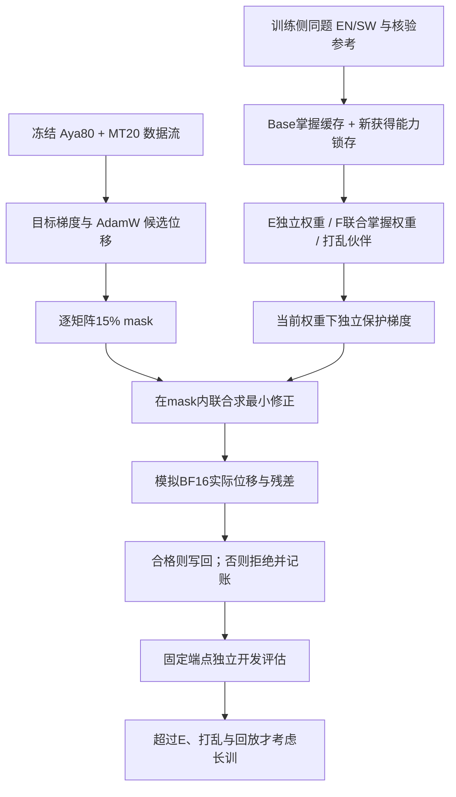

# 配对能力约束稀疏微调：算法审查与首轮规格

2026-10-21。状态：研究假设与最小原型，尚无方法有效性结论。来源分支 `research/on-policy-sparse-cl-20261009`，基点 `4bba25f5de5947bf7e8ad704f9a7a4a0da4e7460`；本轮分支 `research/paired-capability-sparse-20261021`。独立检出，历史代码和产物不修改。

## 上下文修正与核验范围

实际读取引用聊天最近全部五组可见轮次，其末轮更正为 Aya80＋MT20。聊天中的图片附件不可通过文本工具读取；服务器 manifest 已独立证实配方，无需据截图猜测。该聊天所说旧 D2 主线由用户后续选择覆盖；历史 CHOICE.json 的 D2 选择原样保存，不改写。

已读指定仓库总览、旧优化器和 trainer、方法介绍、configs、training_costs、假期报告索引、OP-RASP 方法/计划/核心。GitHub API 确认研究分支头，再独立 clone。不能用本机 main 的脏文件代表研究分支。本轮对指定源码与本地模型、manifest、训练/评估收据重算 SHA；逐题文件已定位并重算哈希，未独立逐条重新评分。具体路径、大小、hash 和边界在 SOURCE_AUDIT.json。

新版冻结流：84,930 个不重复样本；15,360,935 非 padding 输入 token，5,984,371 shifted 监督 token，42,465 次 batch2 更新。最大真实长度2035，上限2048；三个桶实际输入 token 为12,288,845 / 1,536,029 / 1,536,061，末条完整样本使比例略偏离目标80/10/10。旧22,146步、12,175,915监督token不能套用。

已用CPU mmap直接读取Aya80MT20终点optimizer：338组exp_avg和exp_avg_sq均为BF16，只有step为FP32；并非仅凭优化器名称推断，详见DENSE_OPTIMIZER_DTYPE.json。

新版 Dense 终点权重 `0ce061b1…` 与 TRAINING_DONE 一致，约9.06 GPUh，分配显存峰值15.16GiB。旧 Dense 是标准 PyTorch BF16 AdamW 状态，拟议稀疏组为FP32动量，不能直接当作唯一优化器匹配基线。既有中间checkpoint只有33972、42465，没有2048步，不能推断短训表现。

新版同协议历史正式报告：Base→Aya80MT20，SW阅读37.56→46.44，摘要25.04→31.77，EN→SW17.20→37.03，SW→EN20.98→43.00；EN阅读81.78→77.89，IFEval prompt41.04→23.66，GSM strict29.49→16.30。说明新配方仍有保持问题，但仅一训练实例，不能声称跨seed稳定。另一个历史总览Base GSM31.69属于另一协议，禁止混用。上述正式分数是历史动机，不能用于本轮调参。

## 关键审查结论

1. E把EN、SW分别求梯度后拼成约束，与配对ID无关，是多语言能力约束基线。四种对错状态若仅决定保护各自正确的一侧，也仍然可按单语独立实现，不能声称使用配对。
2. 投影实际AdamW更新、最小欧氏修正、只修违反候选、保留原动量推进，已有UP-MOPD直接先例；不是本轮创新。与GEM的稀疏支持/状态位置差异是实现与场景差异，不自动构成研究贡献。
3. 本轮只把“同题另一语言的掌握状态是否改善保护信号”作为待否证假设。最小F采用明确的联合权重，不宣称有理论优势；必须同时比较E、打乱配对F、回放。
4. CE和答案间隔都只是能力代理。校准梯度局部安全不推出生成正确性，也不能控制累计漂移。BF16可能使理论可行位移变成有害实际位移，必须检查或拒绝。
5. 昨日双语材料128题仅79题获助手暂时接受，33构造/46验证，其余隔离；已有模型诊断、不是新盲测，也非独立母语金标。旧启动门槛失败不是本轮“有效配对”证据。COPSD库另有同源划分和参考错误，不直接复用。正式MGSM/PolyMath及其跨语同源题不用于保护或选参。

## 最小F定义：联合掌握权重

对训练侧同题ID `i`、语言 `l`，缓存保守掌握标签 `k[i,l]∈{0,1}`。自己的错误输出不作为保护目标；损失目标始终是已核验参考。

E使用 `w[i,en]=k[i,en]`，`w[i,sw]=k[i,sw]`。

F使用：

```
w[i,en] = k[i,en] * (1 + k[i,sw])
w[i,sw] = k[i,sw] * (1 + k[i,en])
L_l = sum_i w[i,l] * CE(reference_i,l) / sum_i w[i,l]
```

含义：两语都已掌握的同题获得2倍保护权重；只有一语掌握则保护该语，另一语没有错误行为约束；都不会的题不保护。它检验共同掌握是否是更可信的保持锚点，不代表“EN对SW错最值得保护”的另一套假设。alpha固定1，不搜索。

打乱控制只置换伙伴ID，保留每条题的文本、参考、自己掌握标签和顺序：EN的伙伴取SW[perm]，SW对应逆置换。每种语言的样本集合与总处理token不变。F权重一般改变，E不变。若全体掌握状态相同或正规化后权重相同，F退化为E：真实数据池必须记录权重、梯度差与激活差；Base退化只说明初始F/E相等。按冻结D1024缓存检查训练中新掌握的分层；若固定门槛仍不足，取消冗余F/E/打乱训练，不能靠命名维持一组。

这仍是简单联合选择启发式；与英语单语难度/目标语难度等因素可能混杂。E与打乱F有相同配对材料曝光，回放另检查额外监督作用；不能仅凭F优于A判定配对有效。

## 掌握判定、缓存与刷新

比较池已冻结29对（原33构造题中4个歧义题在新出分前排除），来源ID、完整推理参考、精确算术和划分均已审核。每题每语：1次greedy，加3次固定seed采样（相同batch/顺序，每batch派生seed，非逐题独立generator），温度0.7、完整softmax、无top-k/p截断；最多512新token，EOS计入，截断/无法提取/答案错误均失败。greedy正确且至少2/3采样正确才记为已掌握。这是小预算保守启发式，不是高置信能力证明；报告原始4次输出与Wilson区间，不将采样次数当独立题数。

Base缓存固定，作为不可撤销的保护下限；不因训练中一次答错解除保护。训练每512步刷新同一池。新掌握须连续两次刷新通过同一条件才加入，加入后锁存；保护不足会体现在独立dev，不可通过删除失败题提高分数。短2048步中新获得状态证据有限，单列Base/新获得标签与分数。

每轮29对最多118,784生成token，Base加四次刷新上限593,920；模型、模板、题目、seed、解析器、结束状态、语言、缓存版本均记hash。该生成预算对D/E/F/打乱/回放相同，未使用信号也明确计费。不同模型会形成不同掌握状态，属于方法路径差异；另保留固定Base标签诊断，但不临时追加训练。

## 能力损失与代理审查

首轮参考答案CE：每条assistant答案含EOS，prompt/pad不计，先样本平均再按权重平均；英语和SW输入使用同一输出语言要求，或各自经过审核的本语参考，二者必须冻结一种，不能混用。

全解题CE会保护措辞、冗长和参考错误；目前源参考确有不严谨中间推导，最终答案正确不等于整段可当监督。必须审核或修订全参考，不能直接以源库可信代替检查。工程短跑只用数字gold+EOS的短CE，明确不是全解题CE有效性验证。

答案间隔候选 `L=-(logP(a+|x)-logP(a-|x))`：先以Decimal/Fraction/符号检查可判定的数值等价，排除0.5/1/2、千分位、负数、单位等伪错误；错误答案来自可验证算术扰动/已有经核验错误，不把别的正确解当负例。分别列候选token长度，sum logP与长度归一版本不混称；固定提示模板、自然回答前缀，不把强制boxed前缀结果当长推理能力。至少比较参考CE与间隔对greedy/采样正确性、真实一步变化的相关性和误判案例，禁止看正式测试选择代理。由于数据/参考尚未验收，间隔本轮未放行训练。

## 优化与数值规格

`d`是实际参数位移（加到theta上），因此保护损失梯度满足 `g^T d<=eps`，不要把下降方向符号弄反。

```
目标batch2逐样本CE -> 累积梯度 -> 全候选clip到1
用目标梯度一次推进m/v，FP32，beta=(.9,.999)
d0 = -lr*mhat/(sqrt(vhat)+1e-8) - lr*wd*theta
每矩阵floor(.15*N)按|m|稳定排序，20步刷新mask
B额外以原英语敏感度缩放排名；A/D/E/F使用相同原无保护排名规则
z = M*d0
在当前权重上顺序计算独立g_en/g_sw，autograd.grad、eval、隔离RNG
A = [M*g_k]，在全196矩阵的支持并集上求一个联合QP
K=A*A^T，b=A*z-eps；小维FP64 active-set；lambda>=0
候选 d=z-A^T*lambda
先模拟 BF16(theta+d)-theta，重算同一g的残差
若BF16实际残差>eps+1e-12：整步权重写回拒绝，动量仍已推进一次
否则只写mask内坐标；记录稀疏名额与非零写回、并集、范数和残差
```

在mask限制下必须用`M*g`作投影法向；先全空间投影再mask一般不等价。约束最多8个（首轮2个语言聚合约束）；不能把几千题约束塞进枚举求解器。聚合约束允许题间抵消，不是逐题保证。无违反时保留原候选；不将裁剪或投影后的方向回灌/二次推进动量。数值失败终止并保留日志，不偷偷修改eps。

mask每20步变更；约束梯度每步计算，无梯度跨步缓存。正确性缓存512步刷新与梯度刷新不同。CPU存保护梯度与支持内候选/Gram，GPU保FP32动量；按矩阵分块构造统计，约束顺序反传，不降精度。FP32投影后转回FP32位移与BF16写回都统计残差；当前实现明确提供record/reject两种策略，比较固定reject。

高拒绝会退化为只推进动量、无法学习：前32个非零LR步骤>50%拒绝立即停止该规格，不临时放宽阈值。多步漂移、曲率、噪声、未覆盖能力不会被这个局部约束排除；后续只能用独立生成dev判断。

checkpoint需包含模型、FP32 m/v、step、mask/并集、scheduler位置、全部RNG、掌握缓存/锁存与题目位置、输入索引、配置hash。恢复时先校验身份再读下一batch。新恢复输出目录保留旧FAILED与checkpoint，禁止覆盖失败证据。



## 对照、预算与止损

完整拟议矩阵含：同候选范围Dense FP32、A无保护、B旧英语敏感度、C HFT15模块基线、D英语约束、E双语独立约束、F联合掌握、F打乱伙伴、R等曝光CE回放。C的真实比例按模块粒度报告，不能伪称逐矩阵15%。完整Dense FFT历史终点另列，不能代替新候选范围Dense或FP32匹配前缀。

最有区分力的首批为A/E/F/F打乱/R，D/B/C及Dense用来解释主效应；统一2048步正式42465步cosine日程前缀、warmup2124步，不能2048步内衰减到零。2048步仍未完全走出warmup，可能看不到后期遗忘，报告这一局限；不因无显著差异临时加checkpoint/步数。主数据、参考池、额外前后向、掌握生成安排匹配；回放用同一保护CE直接加到目标，预设系数0.1，不搜索。D也处理SW校准但不用其约束，未利用计算单列。

拟议总上限32 GPUh，每训练组3 GPUh，含校准/生成成本和dev；超限停止并报告未完成，不能偷偷改算法。当前只有1 GPUh技术检查获预检放行，比较的预算/样本与科学门槛见plan.json，其状态明确为gated，不能把“计划”说成“已运行”。

开发只一个训练端点、不挑中间结果。现有已看过的dev只作诊断；新保留dev须冻结共同原题组、近重复审核、样本hash、生成/评分模板，再产生任何组分数。SW阅读/摘要/翻译是适配主指标，EN阅读/IFEval/数学是保持；不以PPL选方法。固定10,000次题目组配对bootstrap，seed42；数学严格格式和等价答案分开。

准入长训：F相对E及打乱F至少一个预声明保持主指标配对区间完全为正，且SW阅读非劣界-2pp，摘要/翻译-1chrF++，不靠任务平均掩盖退化；还需未使用确认切片复核。与R相当或更差、配对不改变实际梯度/更新、质量划分未过、BF16高拒绝、显存/存储/时间预算不满足，均不升级。正式测试只在方法/超参冻结后执行，当前未启动。


## 构造题退化审查后的决定（产生任何新方法分数前）

已读取并核验昨日原始RECORDS的SHA，仅使用33道构造题，不使用验证题作本次选择。按原有“两种greedy格式都对”的稳定诊断：英语25题、SW0题、共同掌握0题。调用本轮实际pair_weights函数后，E、F、打乱F的归一化权重完全一致。该诊断不是新1+3采样掌握协议，不能声称新标签必然相同；但不能无证据地指望新采样会创造足够共同掌握样本。

**因此停止把目前的共同掌握F推进成三组训练。** 下一阶段改为A无保护、D英语实际更新约束、R等曝光CE回放三组，先验证保护是否超过简单监督。D是已知更新投影思想的迁移基线，不作新算法声明。每步固定循环取2对（2EN+2SW），三组执行同样校准前后向，A全部丢弃，D只用英语约束，R用同一CE辅助项，未利用计算单列。三组仍共享2048步正式日程前缀、主训练流与端点评估；总上限32GPUh、每训练最多6GPUh，超限停止。方案变更及理由已写plan.json，发生在任何新方法分数产生前。

若D不超过R/A或目标语退化，停止能力约束路线扩展。只有新提出的配对机制在真实冻结池上能改变梯度/更新，并有明确最近邻差异，才重开E/F/打乱的比较；不为凑“新方法”增加复杂模块。旧F实现保留为退化可复现反例。

存储按观测单checkpoint约16.19GB估算：首批三组加20GiB余量需要约70GB，而当前约28GB可用。完整九组约167GB。没有删除历史文件；已询问本账号可用的替代存储目录。该限制与科学/实现门槛独立，得到新路径不会自动放行未验收实验。

## 实测数值与成本发现

最初恢复实测因新旧两套FP32动量同时驻留而OOM；已改为逐张量复用缓冲区。默认CUDA路径的两次重放未逐位一致；确定性算法和CUBLAS工作区配置后，同checkpoint的模型、动量、mask及所有指标逐位一致。失败v1/v2与成功v3均保留，不能删除失败只展示成功。

完整动量预先驻留后，2035/2030 token两个最长样本的一步检查通过。它给出真实BF16反例：英语梯度对理论位移的内积-0.02161255，舍入后变成+0.02577983；整步按固定规则拒绝，实际残差0、非零写回0，而动量仍推进一次。它证明需要舍入复查，不证明全任务不遗忘。

原布尔索引版本优化器实测17.56–17.66秒/步，2048步仅优化器就约10小时，不能直接满足拟议32GPUh三组含评估预算。随后缓存按展平位置升序的支持索引，避免每个矩阵多次CUDA nonzero/同步与跨设备mask搬运；候选、QP、数值精度和写回策略不变。23项CPU测试中含与已验证旧实现的逐步完全一致对照。真实性能和逐位等价结果另附，未达成本门槛不启动三组训练。

D首批校准只针对英语数学参考能力，是保护基线；不能把它称为覆盖全部英语能力的保证。SW配对诊断要求两种输入语言使用相同英语输出，仅测跨语输入条件，不代表SW生成能力；SW阅读、摘要和翻译仍须在独立dev分别测量。

存储后续复核：已在/data1世界可写sticky数据盘建立本账号专属目录，从/data0统一checkpoint下建立comparison软链接，UID与读写核验通过，未移动任何旧文件。先前存储缺口已解除；成本门槛仍未通过，详见STORAGE_PREFLIGHT.json、COST_AND_EQUIVALENCE.json和COMPARISON_PREFLIGHT.json。


## 当前冻结入口（覆盖此前条件性计划）

当前权威配置为 `experiments/paired_capability_sparse_v1/comparison_protocol.v1.json`，在新Base掌握状态和开发成绩产生前写入。原plan移至plan.technical-history.json留作过程证据。总32GPUh不变，正式2048前缀每组上限7.5GPUh；原6GPUh分配在出分前重新分配，但没有抬高总预算。主前缀734,542输入、287,963监督token；不能将旧D2前缀套入。

29题完整参考统一英文推理输出（SW是输入语言），不保护模型错误回答；四个原题因语义歧义预先排除。fullCE作为首轮训练代理固定，sum/length-normalized答案间隔只作Base诊断，不看结果选择训练代理。Base至少8道EN保守掌握，否则不启动比较。

F/E/打乱的条件门槛只看固定D1024缓存：至少8题双语掌握、8题仅EN掌握，不搜索分叉点。若BaseSW掌握为0，按连续两次刷新滞回规则，直到1024前D/E/F/S的权重和实际更新路径相同；只有核验完整模型/优化器/RNG/掌握缓存后才能复用D1024。若不相同，必须各自从Base完整训练2048步；总预算不足则记录配对贡献未验证，不能伪造或借用不等价前缀。

开发集v4共1024条：FLORES原版dev按文档128组双向256、SW摘要128、KenSwQuAD128、RACE256、GSM训练来源128、IF-multi训练来源128。新正式测试不评分。FLORES前32示例所涉全部文档、devtest全部文档和旧精确示例文档均排除；其他开发源按共同ID/文章分组并检查主流重合。数值与近邻检查不能证明完全语义去污染。

新增eval/compare入口固定单2048端点，官方兼容IF检查、数字等价、严格选项、SW tokenF1、chrF++和按共同原文档成组的10000次配对bootstrap。D即使通过筛选也只是已知保护基线；配对结论还需要完整E/F/打乱/回放对照，长训另需强基线和未用确认片。
