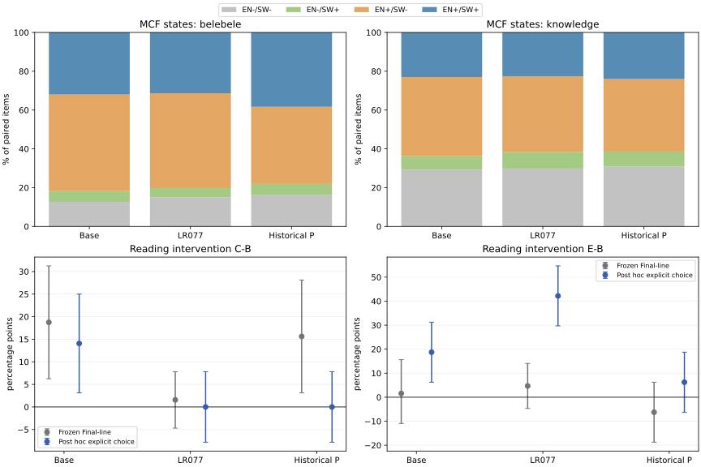

# 跨语言能力访问缺口诊断：完成报告（2026-10-28）

**本轮没有训练。已补齐历史英语保护模型4项统一MCF评测，复用其余缓存，完成三个模型的1920条A–E回答。结果确认存在大量同题双语表现差异；英语原文帮助近期LR077的SW阅读选项判断，但不能据此认定内部访问通路已被定位，更不能直接推出新训练方法有效。**

**关键质量问题：原生成协议把独立Final行和答案内容绑定过紧。** 冻结分数保留，但它主要是“内容正确且满足可提取格式”的联合成功率。明确选项后接解释常被记为提取失败；本文将原分数、事后格式敏感性和MCF正式任务形式分表。事后规则不能冒充提前冻结的确认结果，不据此选择模型或超参数。

## 三句话汇报

统一选择题协议发现，Base的900道双语阅读中有448道英语对/SW错，570道双语知识题中有232道出现这种差异，但单次正确并不认证稳定掌握。A–E干预显示，提供对应完整英语内容可能帮助SW阅读，近期LR077在事后明确选项解析下由17/64升至44/64；英语解释要求的收益则没有跨模型、跨任务稳定出现。该发现只支持保留输入语言/能力访问的研究假设，尚不足以据此启动选择性训练；下一轮须先把内容判分与格式遵循分离，并核查训练侧可复现性与创新边界。

## 范围与资源核查

模型固定为Base、LR077-s42、历史element_protected。LR077是近期Aya80/双向翻译20的4293步、1.536M输入Token前缀；历史保护是D2 FineWeb70/Aya10/双向翻译20的22146步、15.36M输入Token完整预算。仅分别观察其相对Base的变化，不能把二者当严格算法效果对照。

Belebele900对按原文档与问题号配对，知识570对按原ID和学科配对，选项正确标签一致。Base/LR复用已验收缓存，历史保护使用同一v2补评；原始四选项logprob重新计算的分数、输入Token与金标跨模型一致。历史Belebele自身few-shot问题已由同源文档排除修复，旧v1结果不混用；知识两语言few-shot内容不同，仍不是纯题目语言反事实。

结构ID/标签匹配不认证译文质量。选定128对中有6对数字表面字符串差异标记，未人工双语验收，未据此删题或重抽。材料已暴露，属于开发诊断，不是独立最终测试，更不能把这些benchmark题用于训练、保护池或选择性选样。

## 全体MCF能力观察状态

以下是同一题在两个语言版本上的单次协议观察，不是“已掌握/未掌握”的可靠标签。

|任务|模型|题数|双语都对|EN对/SW错|EN错/SW对|双语都错|EN ACC%|SW ACC%|
|---|---|---:|---:|---:|---:|---:|---:|---:|
|belebele|Base|900|288|448|50|114|81.78|37.56|
|belebele|LR077-s42|900|282|440|43|135|80.22|36.11|
|belebele|历史英语保护|900|345|358|52|145|78.11|44.11|
|knowledge|Base|570|131|232|40|167|63.68|30.00|
|knowledge|LR077-s42|570|129|222|49|170|61.58|31.23|
|knowledge|历史英语保护|570|137|213|44|176|61.40|31.75|

Base的EN对/SW错比例为阅读49.78%、知识40.70%。这些题可能混合语言理解差异、翻译质量、提示/示例差异、碰巧猜对或其他因素；不能把全部计作完整知识无法访问。

## Base到适配模型：得失同时报告

|任务|适配模型|EN对→错/原EN对|EN错→对/原EN错|SW错→对/原SW错|SW对→错/原SW对|
|---|---|---:|---:|---:|---:|
|belebele|LR077-s42|41/736|27/164|113/562|126/338|
|belebele|历史英语保护|54/736|21/164|174/562|115/338|
|knowledge|LR077-s42|43/363|31/207|66/399|59/171|
|knowledge|历史英语保护|40/363|27/207|71/399|61/171|

完整4×4状态转移与来源区间见`MCF_STATES_AND_TRANSITIONS.json`。阅读按原文档同步重采样，知识按学科内题目重采样。表中分母分别为Base对应对/错集合，完整题数同时保留。净分数接近不能说明逐题能力没有变化；答错也不能直接证明知识被擦除。

## A–E生成干预及冻结分数

固定哈希选择阅读64来源各1题、知识64题覆盖57学科；未按模型得失选题。每模型640条，三模型1920条。A为EN题/EN解释；B为SW题/SW解释；C为SW题/EN解释；D为EN题/SW解释；E为SW题附对应完整EN题/SW解释。各条件使用相同Base模板、零样例、greedy、BF16、batch4、生成上限256。最长提示1518 Token，共同输入上限1536，不截题。

E没有附金标或参考解释，但增加了可读的完整英语语义内容和上下文长度。它是英语辅助输入条件，不是纯内部路径干预；其成绩不能称为无英语辅助SW benchmark提升。

下表是原冻结独立Final行协议的正确数/64，原分数不改写。零样例生成与3/5-shot MCF属于不同协议，不能将二者分数直接相减解释为遗忘。原字段format_compliant仅核对唯一独立Final行和非空其他文本，不认证Final是否最后一行、解释是否单句或指定语言；语言另报。

|模型|任务|A|B|C|D|E|
|---|---|---:|---:|---:|---:|---:|
|Base|belebele|50|13|25|42|14|
|Base|knowledge|33|15|21|29|12|
|LR077-s42|belebele|17|6|7|17|9|
|LR077-s42|knowledge|17|4|5|12|13|
|历史英语保护|belebele|46|19|29|12|15|
|历史英语保护|knowledge|31|10|17|6|11|

## 格式问题与事后敏感性（与主表分开）

固定哈希案例中可见明确选项后紧接解释、选项与内容同一行、只输出字母等情形。原规则会把它们记为提取失败。阅读B条件的提取失败：Base16/64、LR07747/64、历史保护24/64；E条件分别42/64、52/64、38/64。因此不能把原表中的失败全部解释为内容错误或访问障碍。

事后解析只接受唯一明确Final/Answer/Jibu选项声明，或无歧义的开头选项；拒绝矛盾声明、多选及选项罗列，不使用模糊语义匹配或最后字母兜底。13个受控案例通过；所有1920条回答统一处理，没有重新生成。**规则是在看见格式失败后制定，属于探索性诊断，不替换冻结表。**

|模型|任务|A明确选项对/64|B|C|D|E|
|---|---|---:|---:|---:|---:|---:|
|Base|belebele|52|16|25|49|28|
|Base|knowledge|34|22|21|34|21|
|LR077-s42|belebele|49|17|17|46|44|
|LR077-s42|knowledge|29|14|12|28|24|
|历史英语保护|belebele|49|30|30|46|34|
|历史英语保护|knowledge|32|17|17|24|18|

所有生成表中的未解析项均保留在分母并记为未成功，不能等同于内容错误。事后规则下阅读B/E未解析数：Base为6/12，LR077为0/4，历史保护为0/0；知识B/E分别为1/14、5/3、1/0。

选择字母的明确性不认证解释内容正确，仍有未解析答案；计分对语义与语言的覆盖有限。不同模型的预算不同，本表不能作算法排名。

|事后比较|差值（百分点）|来源配对95%区间|
|---|---:|---:|
|Base/belebele/C-B|+14.06|[+3.12, +25.00]|
|Base/belebele/E-B|+18.75|[+6.25, +31.25]|
|LR077-s42/belebele/E-B|+42.19|[+29.69, +54.69]|
|Historical-element_protected/belebele/C-B|+0.00|[-7.81, +7.81]|
|Historical-element_protected/belebele/E-B|+6.25|[-6.25, +18.75]|
|Base/knowledge/E-B|-1.56|[-17.46, +14.52]|
|LR077-s42/knowledge/E-B|+15.62|[+0.00, +31.03]|
|Historical-element_protected/knowledge/D-A|-12.50|[-23.81, -2.90]|

上述为事后来源聚类bootstrap10000次，知识干预小集按学科来源聚类，与全570题的学科内重采样口径分开。区间反映固定模型、固定开发题的不确定性，不代表训练随机性或多重比较确证。

## 可以支持与不能支持什么

- **可以保留输入语言/英语辅助访问的线索。** 明确选项诊断中，Base阅读E−B为+18.75个百分点；LR077为+42.19。LR077全64题有28题由B错变E对、1题反向变化，净增27题。A对/B错的34题中，27题E正确；这是条件性描述，不是“79%的访问缺口已修复”。
- **不支持把“改用英语解释即可修复”当普遍机制。** 历史保护阅读的冻结C−B为+15.63，事后解析后为0；原差异很大程度伴随提取格式。Base阅读C−B仍有正向信号，但知识任务及其他模型未稳定同向，不能推广。
- **输出语言干预并未可靠执行。** 阅读D的解释语言启发式匹配SW分别为Base21/64、LR0770/64、历史保护39/64；阅读C匹配EN分别63/64、5/64、0/64。只给字母的答案语言不可判，短句检测也不可靠。不能由C/D差异单独定位输出语言瓶颈，更不能由无差异否定该瓶颈。
- **英语辅助不是跨任务万能修复。** 事后知识E−B在Base和历史保护上区间较宽且跨0；LR077知识的区间下界为0。历史保护知识D−A有负向诊断信号，但语言、解释行为与格式尚未完全控制，不能等同于知识遗忘机制。
- **已有能力得失必须逐题观察。** 历史保护阅读总SW分数上升，同时出现174个SW错→对及115个SW对→错；整体提升不能掩盖局部退化，也不能由答错断言内部知识丢失。

## 研究判断与最多一个后续候选

保留“部分目标语言失败可能与输入理解/能力使用有关”的假设；本轮不能建立内部因果通路，也没有验证任何新的训练算法。现阶段不启动新训练，不直接按这些benchmark题挑监督材料。

若继续，只保留一个可证伪候选：**在独立训练侧平行材料中，先可靠识别SW独立失败、英语辅助后成功的状态，再检验这种选择是否比同数量随机样本和高损失样本更有效。** 前提是先冻结内容与格式分离的评分，并检查同题稳定性、翻译质量和近邻工作；各组匹配Token、更新与数据曝光，额外英语推理单列。当前结果尚未满足直接开展该训练的条件。

持续学习论文后续仍需验证新语言学习与英语/已学语言保持；单次SW诊断不等于完整多阶段CL验证。

## 验收与产物

本轮新增历史模型MCF判断2940次，复用其余5880次；1920条新回答全部保留。七个GPU上下文均正常闭合，共0.582 GPU小时，等待不占GPU，无总时长上限；全账号最多四卡。没有新训练或失败重跑。

- `MCF_STATES_AND_TRANSITIONS.json`：全体观察状态、转移及区间。
- `INTERVENTION_TABLE.csv`、`INTERVENTION_COMPARISONS.json`：原冻结分数与区间。
- `POSTHOC_FORMAT_SENSITIVITY.json`、`POSTHOC_CONDITIONAL_COUNTS.json`：事后解析与条件性描述。
- `RAW_ARTIFACT_ACCEPTANCE.json`、`COSTS.json`：原始缓存重算验收与成本。
- 原题、逐题配对与输出留服务器。固定8题、全模型全条件案例亦留私有目录；未做母语者人工语义验收，不将助手诊断当人工金标。

本轮到此结束，不自动追加提示、样本、层位、超参数或训练；报告交给研究讨论后再决定下一轮。

可审阅执行与评分代码归档：[`scoring.py`](../../../experiments/access_gap_diagnostic_v1/scoring.py)、[`posthoc_format.py`](../../../experiments/access_gap_diagnostic_v1/posthoc_format.py)、[`generate.py`](../../../experiments/access_gap_diagnostic_v1/generate.py)。协议和源哈希见`PROTOCOL_AND_IDENTITIES.json`。代码保留服务器工程依赖与路径，未宣称提供脱离本地数据/环境的便携复现包。
