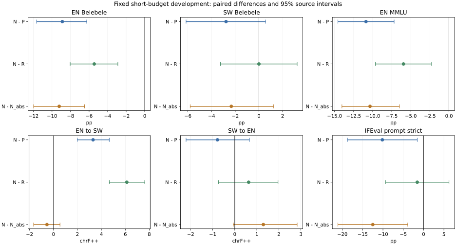

# 方向风险选参五组实验：完成报告（2026-10-28）

**五组4293步匹配短训、统一benchmark开发筛查和完整恢复产物核验均已完成。N没有通过冻结推进门槛，停止本候选，不新增第二顺序、SSU/HFT或参数扫描。**

## 三句话汇报

完成U无保护、P英语敏感度、R同池回放、N正方向风险、N_abs绝对风险五组真实训练，并统一评测Belebele ACC、MMLU类任务、双向翻译及官方IFEval子集。N提高了EN→SW翻译，但明显损伤英语阅读、知识与指令表现，未体现所设想的保护优势。P仍是较有价值的简单保护基线；N_abs出现不同任务取舍，但不构成总体胜出，按预定规则结束当前原型，转向已授权的无训练能力访问诊断。

## 完整结果

各列分别比较，不计算跨指标相对Base变化均值。ACC分母：Belebele每语言900、知识每语言570、IFEval128条提示；翻译每方向128题。

|模型|SW Belebele ACC%|EN→SW chrF++|SW→EN chrF++|EN Belebele ACC%|EN MMLU ACC%|SW Global-MMLU ACC%|IFEval prompt strict%|
|---|---:|---:|---:|---:|---:|---:|---:|
|Base|37.56|17.65|16.88|81.78|63.68|30.00|39.06|
|U|34.33|18.28|28.30|79.11|60.00|29.12|26.56|
|P|37.67|20.55|29.54|81.33|63.68|28.95|32.81|
|R|34.89|17.73|28.13|77.89|58.77|28.42|24.22|
|N|34.89|23.86|28.76|72.44|52.81|31.75|22.66|
|N_abs|37.22|24.40|27.46|81.67|63.16|30.18|35.16|

## 主要配对差值

|比较与指标|差值|来源配对95%区间|
|---|---:|---:|
|N−P，EN阅读ACC|-8.89|[-11.66, -6.26]|
|N−P，EN MMLU|-10.88|[-14.56, -7.19]|
|N−P，IFEval prompt strict|-10.16|[-18.75, -1.56]|
|N−P，EN→SW|+3.30|[+1.98, +4.66]|
|N−R，EN阅读ACC|-5.44|[-8.04, -2.90]|
|N−R，EN MMLU|-5.96|[-9.65, -2.28]|
|N−N_abs，EN阅读ACC|-9.22|[-11.98, -6.49]|
|N−N_abs，EN→SW|-0.55|[-1.66, +0.54]|
|N_abs−P，EN→SW|+3.85|[+2.40, +5.30]|
|N_abs−P，SW→EN|-2.08|[-3.68, -0.57]|

阅读、知识和IFEval差值单位为百分点；翻译为chrF++。来源同步bootstrap10000次；区间仅反映本批固定模型的题目不确定性，不代表训练随机性总体。单顺序、小预算、已暴露开发材料不能升级为正式方法结论。

## 有价值的发现与边界

1. **本轮有符号选参保护失败。** 相对P，N的英语阅读下降8.89个百分点、EN MMLU下降10.88、IFEval prompt strict下降10.16，三项配对区间均排除0；EN→SW上升3.30，不能补偿预定保持门槛的失败。N相对R的英语阅读与知识也更差。SW阅读的N−P区间跨0，不把所有点估计下降说成统计确定。
2. **保留方向信息没有自动带来好处。** N相对N_abs的英语阅读、知识与指令更差；EN→SW没有可靠额外优势。这里比较的是具体公式、校准池和陈旧梯度日程，不能否定所有有符号方法。
3. **绝对风险消融也存在真实取舍。** N_abs比P的EN→SW高3.85 chrF++，但SW→EN低2.08，两项配对区间均排除0。阅读、知识和指令的相对P差异仍不确定。不能看见消融较好就事后更换主方法、自动长训或宣称Pareto改进。
4. **旧敏感度保护仍值得作为基线保留。** P相对Base的阅读与EN知识点估计接近，双向翻译改善，IFEval仍低6.25个百分点且区间较宽；这不等于证明所有原能力都保持。相同池的0.1间歇回放并未成为本轮强赢家，也不能外推为回放普遍无效。
5. **更新幅度不是因果结论。** N_abs的累计实际BF16路径和终点净位移明显小于N/P，不能把其表现完全归因于无符号风险。当前不追加位移匹配或学习率扫描。N为何失效仍有梯度代理、校准代表性、陈旧性等候选解释，未做因果验证。

## 更新、恢复与成本

|组别|累计实际BF16更新路径|终点净位移|最终mask并集|非零写回事件|
|---|---:|---:|---:|---:|
|U|269.970|15.774|1247581518|68373675809|
|P|263.653|15.531|1244639939|65870277760|
|R|269.916|15.778|1247555812|68389741447|
|N|223.255|14.123|1243523550|41569285790|
|N_abs|157.796|7.566|1196553220|12110138456|

“非零写回事件”跨步累加，并非独特坐标数；mask并集也不等于每个入选位置都发生了BF16变化。五组逐步名额、完整4293步日志、曝光与TensorBoard已核验，最终state.pt和模型全部保存文件哈希重新计算通过。

本轨道GPU上下文记录：已闭合实测10.794小时；中断结束时间估算4.660小时；合计15.454小时。另列1小时不确定性余量，不称为已实际消耗；含该余量账本为16.454小时。七模型benchmark接轨另为1.375小时。无累计时间停止限制，四卡为资源上限。

真实物理显存为每5秒采样的观测峰值，见GPU_COST_CONTEXTS.csv；中断未落盘的峰值保留缺失，不能用allocated值补造。

## 问题与比较

研究Qwen2.5-1.5B-Instruct学习斯瓦希里语时，在相同逐矩阵元素名额下，利用英语校准损失梯度与AdamW候选实际位移的有符号关系选择参数，能否比旧敏感度保护和同池回放更好地兼顾SW学习与英语保持。

| 组别 | 规则 | 作用 |
|---|---|---|
| U | 动量幅度选参，无英语保护 | 无保护稀疏基线 |
| P | 平方英语梯度敏感度保护选参 | 无方向保护基线 |
| R | U加同池英语参考CE回放，系数0.1 | 额外监督的简单对照 |
| N | 只惩罚英语梯度×候选BF16位移的正风险 | 有符号方向风险候选 |
| N_abs | 对同一乘积取绝对值后惩罚 | 检验符号是否有价值 |

N/N_abs只改变入选元素，写入原AdamW候选位移；本轮没有投影或更新方向修正，没有EN/SW配对选样，也没有LoRA、OPD、表示对齐或子空间约束。该局部代理不提供不遗忘保证，梯度乘更新本身不作为创新声明。

P沿用旧敏感度评分公式，但采用本轮统一校准安排，不等同于旧D2整套训练。旧D2的FineWeb70/Aya10/双向翻译20、15.36M输入Token结果仅为历史依据，不能作为本轮严格对照。

## 冻结配置与额外曝光

五组均从同一Base开始，seed/order42，4293次更新，长度2048，有效batch2。Aya SW与双向翻译按原冻结流曝光，共1,536,351主输入Token和599,469监督Token。完整学习率日程42465步、warmup2124步、峰值3.857e-5，使用相同前缀，不把短训压缩为完整衰减。

196个Attention/MLP二维矩阵逐矩阵floor15%名额，共196,529,312元素/步；每20步更新mask。权重BF16，Adam动量FP32，全部候选坐标的优化器状态每步只推进一次。embedding、head、Norm及bias冻结。近期模块比较的77,070,336名额不能直接视为相同预算。

P/R/N/N_abs各访问1720条校准/回放样本，共389,435额外输入Token和101,635监督Token，校准事件215次；U无此曝光。英语池含阅读、指令与数学参考，未认证为Base可靠掌握池；不声称参考答案均经人工验证。四组材料与呈现次数匹配，但梯度用途、前后向成本及有效训练信号不同，系数0.1不意味着信号强度相同。

校准顺序计算，隔离目标梯度、训练模式和RNG；记录实际BF16写回、mask并集、非零写回事件、分模块位移及GPU物理显存采样。完整状态在2146和4293步保存。

## 统一开发筛查

| 任务 | 每模型样本量 | 主指标 |
|---|---:|---|
| EN/SW Belebele | 每语言900题 | 固定3-shot选项似然ACC |
| EN MMLU / SW Global-MMLU | 每语言570题，57学科各10 | 固定5-shot选项似然ACC |
| EN→SW / SW→EN | 每方向128题 | 语料级chrF++ |
| 官方IFEval固定子集 | 128条提示 | prompt strict；另列instruction strict |

Base与五组使用相同题目、提示、模板、解码和评分。阅读使用已排除同源few-shot的v2协议；知识题严格按原ID配对，但两语言few-shot内容不同，不是纯粹换语言的反事实。IFEval子集不是全量541条成绩，知识题570题不是全量MMLU成绩。

材料此前已经暴露，均为补充评估/开发筛查，不是新的独立最终测试。KenSwQuAD自由回答F1、表示检索、PPL及NLL不作为本轮推进门槛。

配对区间采用固定模型的来源重采样：阅读与翻译按来源聚类，知识题按学科内重采样；不把语言版本当独立题目，也不把题目区间当训练seed总体不确定性。翻译重算语料级chrF++，不平均句级分数。

## 预定推进规则

N必须同时相对P和R满足：EN Belebele至少+1个百分点；SW Belebele不下降超过1个百分点；两个翻译方向各不下降超过1 chrF++；EN MMLU不下降超过1个百分点；IFEval prompt strict不下降超过2个百分点。N_abs比较必须公开。

这些是操作性点估计门槛，不是统计非劣证明；通过也不等于算法成功，仅允许预定的匹配第二顺序与SSU/HFT强基线确认。N失败则归档停止，不自动提升N_abs，不追加系数扫描、比例、种子或训练长度。

## 故障与成本解释

原训练中断与同秒Codex会话Shutdown记录相吻合，未发现他人杀进程的证据；无法由日志确认最终信号来源。恢复改为手动启动的独立一次性systemd协调器，无开机启动或故障自动重启。

P/R从有效2146步完整状态恢复；N/N_abs从Base重跑。恢复的原重叠步日志逐项比较，统计量完全一致不等于曾保存过每个中间点并完成权重逐bit比较。

按用户后续要求，不设置累计GPU小时或墙钟上限，不因达到时间阈值中断既定训练/评测；仍执行全账号最多四卡和异常保护。成本最终区分实测GPU上下文时长、中断估算和单列不确定性余量，不能把余量称为已经实际消耗的GPU时间。

## 验收与交付索引

- `SCREEN_TABLE.csv`、`SCREEN_COMPARISONS.json`：全分数及配对区间。
- `SCREEN_DECISION.json`：冻结门槛逐项失败/通过，最终停止。
- `OUTPUT_BEHAVIOR.json`：全量语言启发式、重复、截断和生成Token；不以语言检测代替翻译正确性。
- `TRAINING_UPDATE_STATS.json`：五组曝光、实际写回与最终完整恢复文件核验。
- `GPU_COST_ACCOUNTING.json`、`GPU_COST_CONTEXTS.csv`：分项成本及物理显存观测。
- 原题、逐题回答、state.pt和权重留在服务器；公开报告仅含聚合统计和可审阅代码。

后续队列仅做已有Base、LR077-s42、历史英语保护模型的同源EN/SW状态转移及A–E语言干预，不自动训练新方法。历史保护模型与近期短训预算不同，仅用于相对Base的机制描述，不作严格算法排名。

代码审阅：[`optimizer.py`](../../../experiments/direction_risk_sparse_v1/optimizer.py)、[`calibration.py`](../../../experiments/direction_risk_sparse_v1/calibration.py)、[`engine.py`](../../../experiments/direction_risk_sparse_v1/engine.py)、[`train.py`](../../../experiments/direction_risk_sparse_v1/train.py)。完整冻结源哈希、模型身份和资源政策覆盖关系见`IDENTITIES_AND_CONFIG.json`。这些脚本保留服务器工程路径，属于可审阅执行归档，不宣称已提供无需本地数据和环境的便携复现包。
