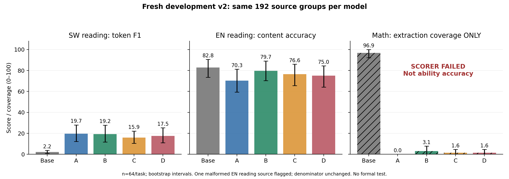
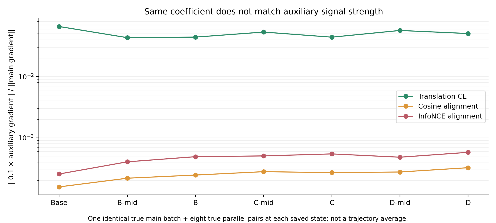

# Qwen2.5-1.5B 表示对齐：评分与机制复核（2026-10-22）

> 仅公开报告、聚合结果、图、配置和代码。原始数据、逐题生成、320条数学回答的私有映射与审阅标签、checkpoint留在服务器。未新增训练、LoRA、OPD或正式测试。

## 三句话口头汇报

1. 已完成五个既有模型各192题、共960条新开发回答，以及8个模型状态审计和21次真实batch梯度探针；阅读结果仍没有显示C/D超过同池翻译CE。
2. 数学v2在290项受控验收通过后，仍严重漏计自然回答，实际验收失败；冻结分数原样保留，另对全部320条数学回答做了明确标为事后的助手复核，不能把自动零分解释成数学能力归零。
3. C/D自身目标在训练池和独立池上有小幅改善，但锚点高度同向、辅助梯度和BF16候选更新影响远小于CE，未转化为超过CE的检索与任务收益；维持停止扩展，下一步优先修好评测验收。

## 任务完成情况与未达标项

| 项目 | 实际状态 |
|---|---|
| P0 阅读/数值/格式受控验收 | 36个独立来源、290项自然参考与受控格式/错误变体，全部通过；评分代码随后冻结 |
| P0 数学真实自然回答有效性 | **未达标**。Dense四组共252/256条提取失败，另有“空标题后接正确多行boxed被误判”的确定实现缺陷 |
| P1 新开发重评 | Base/A/B/C/D全部192题完成，960条回答；每模型SW阅读64、EN阅读64、EN数学64，全部保留分母 |
| P1 源题质量 | 生成前排除两个不同ID同文家族、纠正1个源答案、补明1个整小时条件；生成后又发现1个阅读结构异常和2个数学源题问题，均保留原结果并标记 |
| P2 目标/梯度/状态副本审计 | 全部完成；原checkpoint只读，未恢复科学训练 |
| 可信的独立数学自动评分 | **尚未获得**。事后助手复核只提供证据与不确定性边界，不替代独立人类金标或新确认集 |

这是一轮有明确失败项的验收，不宣称评分问题已全部解决。旧v1、旧POSTHOC、新v2和新POSTHOC助手复核分开保存。

## 新v2：阅读内容、格式与截断分开

| 模型 | SW阅读F1 | SW完全匹配/64 | EN阅读内容正确/64 | EN阅读内容% | 单字母合规/64 | SW截断/64 | 数学提取失败/64 |
|---|---:|---:|---:|---:|---:|---:|---:|
| Base | 2.21 | 0 | 53 | 82.81 | 1 | 27 | 0 |
| A | 19.66 | 7 | 45 | 70.31 | 0 | 5 | 64 |
| B | 19.24 | 7 | 51 | 79.69 | 0 | 5 | 62 |
| C | 15.91 | 2 | 49 | 76.56 | 0 | 5 | 63 |
| D | 17.55 | 5 | 48 | 75.00 | 0 | 3 | 63 |

A=普通Dense SFT；B=A＋同一平行池双向翻译CE；C=A＋固定英语余弦目标；D=A＋固定英语2000候选InfoNCE。两条历史轨道的字母不同，禁止跨轨排名。

EN阅读内容允许明确单字母、字母加对应选项、唯一完整选项；矛盾或复述全部选项不判对。SW保留固定的整段回答token F1/完全匹配，单次Jibu前缀规范化；长篇抄写会降低F1，不能将其变化全部解释为纯理解能力。

新源题结构检查发现1/64个英语题的D选项内嵌E/F/G，且题干与文段对应存疑。原64题分数和区间不改，单项源题不确定性最多涉及1.56个百分点/模型；下面的bootstrap区间不吸收所有源标签错误。短选项的自动语言识别不可靠，仅作诊断。

| 比较 | SW阅读F1差值 [95%CI] | EN阅读内容差值 [95%CI] |
|---|---|---|
| A-Base | +17.45 [+10.38,+25.35] | -12.50 [-25.00,-1.56] |
| B-A | -0.42 [-8.91,+8.24] | +9.38 [+3.12,+17.19] |
| C-B | -3.32 [-10.22,+3.30] | -3.12 [-7.81,+0.00] |
| D-B | -1.69 [-9.51,+5.39] | -4.69 [-10.94,+1.56] |

10000次按共同来源配对bootstrap，seed42。C/D的SW区间跨零，不能独立确认损伤幅度，也没有超过B的证据。EN阅读A相对Base下降、B相对A改善是本次观察；64题、源题瑕疵和单seed限制结论。未补题、未删分母、未根据结果调整提示或解析规则。

图第三栏只显示**数学提取覆盖率**，不是数学能力正确率。

## 数学v2：受控通过，真实回答验收失败

冻结v2数学自动正确数为Base48/64、A0/64、B1/64、C0/64、D1/64。**这些模型间分数不具备能力排序有效性**；原始自动表保存在V2_SCORES.csv，相关数学自动bootstrap也只为归档，不作为功能证据。

最小复现一：`The final answer is:`换行后给出正确多行boxed，解析器把空标题视作另一个无效候选，从而标记含糊。最小复现二：完整自然句“还剩某个金额”缺少受限的answer前缀，即使计算正确也无法提取。前者是实现缺陷，后者是验收覆盖缺口。评分器未打补丁，原输出、冻结哈希和所有分数保留。

为了区分格式漏计与真实错误，对全部320条新数学回答做了事后助手最终答案审阅；同题相同文本去重后281条。审阅包不显示模型名，但助手已看过汇总和少量带标签案例，因此**不是严格盲审或独立人类金标**。长答先看末1400字符，含糊时回看全文；审阅只判断请求的最终结果，不保证长推理每步正确。

| 模型 | 助手认为最终结果明确正确/64 | 错误或未完成目标/64 | 不确定（含源题缺陷）/64 | 已观察正确比例—含不确定的上界 | v2漏计这些正确回答数 |
|---|---:|---:|---:|---:|---:|
| Base | 49 | 12 | 3 | 76.56–81.25% | 1 |
| A | 22 | 39 | 3 | 34.38–39.06% | 22 |
| B | 25 | 37 | 2 | 39.06–42.19% | 24 |
| C | 22 | 40 | 2 | 34.38–37.50% | 22 |
| D | 26 | 36 | 2 | 40.62–43.75% | 25 |

上述是**POSTHOC_NEW_ASSISTANT_REVIEW**，区间是未定项的算术上下界，不是统计置信区间。保留全部64题：新发现的一题源gold与算术矛盾、一题收入比较措辞含糊，所有模型对应观察均记不确定；另有个别符号解释或截断无法定论。没有通过更改源gold、删题或调整解析器重算出一个“成功的v2”。

审阅同时发现正确的自然金额结论被漏计，以及真实的漏因子、单位时间换算错误、忽略题目所问量、无穷算式/重复等错误。这支持“格式问题与真实错误并存”；仍需独立评分验收来量化能力下降，不能拿此助手表确认C/D之间的胜负。

## 原v1与旧事后诊断：保持原样

| 模型 | v1 EN阅读严格单字母% | 旧POSTHOC阅读% | v1 数学格式敏感% | 旧POSTHOC数学flexible% |
|---|---:|---:|---:|---:|
| Base | 5.47 | 78.91 | 78.91 | 74.22 |
| A | 0.00 | 60.94 | 0.00 | 36.72 |
| B | 0.00 | 73.05 | 0.00 | 36.72 |
| C | 0.00 | 67.97 | 0.00 | 35.16 |
| D | 0.00 | 70.70 | 0.00 | 34.38 |

v1和旧POSTHOC使用旧1024题与旧生成设置，不能与新64题当作同一协议直接作差；旧flexible最后数字规则有已知局限。全部轨道原表另存V1_AND_POSTHOC_UNCHANGED.csv。旧稀疏D仍未显示超过简单回放R，配对分支未运行；今天没有新增稀疏训练或跨轨比较。

## 对齐机制：目标改善小，不能等同于功能改善

| 模型 | 固定训练64对：余弦损失 | 固定训练64对：InfoNCE | 独立1000对：余弦损失 | 独立1000对：InfoNCE | 独立固定英语锚检索均值P@1% |
|---|---:|---:|---:|---:|---:|
| Base | 0.003921 | 7.593894 | 0.004088 | 7.594426 | 3.05 |
| A | 0.003938 | 7.590861 | 0.004069 | 7.591667 | 6.25 |
| B | 0.003744 | 7.590942 | 0.003876 | 7.591714 | 7.60 |
| C | 0.003720 | 7.591062 | 0.003860 | 7.591784 | 6.85 |
| D | 0.004263 | 7.590465 | 0.004435 | 7.591361 | 5.95 |

训练池InfoNCE为原2000候选；独立池为自身固定Base正例＋同一2000训练负例，共2001候选，不能跨池直接比较绝对损失。模型间同池比较一致。

C相对B的独立余弦损失差为−0.00001628，配对95%CI[−0.00002723,−0.00000532]；训练64对差值CI跨零。D相对B的独立InfoNCE差为−0.00035406，CI[−0.00047474,−0.00024119]；训练64对也有小幅降低。因此不是简单断言目标完全未被优化；但二者固定锚检索均低于B，也未出现额外下游收益证据。

| 审计问题 | 证据与边界 |
|---|---|
| 实现身份 | 2000对ID与缓存行严格一致，EN/SW编码逐行核验；state index10为第10个decoder block之后，padding不计入均值，内容输入不带聊天模板；dropout为0 |
| 固定缓存 | Base模型/分词器/训练池SHA核验；8个教师向量按原batch形状重放全部逐位一致；五模型各8个独立SW缓存向量与实时前向逐位一致 |
| 重分组数值差异 | 相同8个英语样本改组batch后最大绝对差2.469，平均相对L2为0.1426%，平均余弦差约1.48e-6；原形状重放精确一致，已将此BF16差异单列 |
| 英语锚几何 | 2000个归一化锚的非同题余弦均值0.998722，目标本身已高度同向；方差非零，不把高相似度直接当作语义或功能保持 |
| 已有实际日志 | 4293步全部核验，1073次辅助事件；全程global norm>1，均触发裁剪；日志损失不等于有效梯度强度 |
| 梯度与状态副本 | Base、B/C/D中间2146与终点4293，共7状态×3辅助目标；同一真实主batch和8个辅助句对。复制状态做CUDA foreach AdamW候选，不写原模型或checkpoint |
| 全程局限 | 单一固定batch、有限状态不能证明整个训练每次辅助信号的有效性；状态副本候选也不是历史下一步真实轨迹的重现 |

| 辅助项（都乘0.1） | 所测7状态的辅助/主梯度L2比 | 所测6个已训练状态的BF16候选权重不同坐标数 |
|---|---:|---:|
| B 翻译CE | 4.329%–6.585% | 5,029,491–7,217,590 |
| C 余弦 | 0.01575%–0.03240% | 531–1,087 |
| D InfoNCE | 0.02558%–0.05779% | 2,562–4,296 |

辅助每4步才加入一次；不将这些固定batch比例当作全程平均。BF16“不同坐标数”比较的是同一状态、同一主batch下加入辅助项前后的候选差异，包含裁剪和AdamW作用；不是整轮累计更新名额，也不是训练原权重的额外写回次数。C/D对前10层及embedding提供辅助梯度，主SFT仍更新全部338个唯一参数张量。

## 继续与停止依据

维持停止当前C/D及稀疏保护原型扩展，不追加长训、层位/权重/温度扫描、第二语言或稀疏×对齐组合。新阅读比较没有提供超过B的证据；旧冻结任务门仍未通过。数学自动v2失效，不能拿它支持能力排名，也不能因事后助手表略有差别改选方法。

今天唯一建议的下一步是**下一版评测验收**：在新的未用来源上，先完成明确自然结尾、多行最终答案、矛盾结论、单位与源题结构的独立验收；冻结后再讨论新的确认材料。现有320条已用于发现失效形式，不能再作为新评分器的独立确认集。本任务不执行新生成或新训练。尚无充分依据提出一个值得立即训练的算法修订。

## 成本、原始产物与代码

本次新增科学训练0次，新回答960条。两批worker合计0.676 GPU小时，低于冻结8小时上限；其中生成0.363、机制/表示与教师形状核验0.309 GPU小时。评测逐batch观察的物理显存最大3829 MiB；前半机制审计没有物理采样，不把torch allocator峰值冒充物理峰值。全部任务在16:30前启动、17:15前结束。

启动时本账号已有两张卡的任务，本轮未中断它们；本次只用空闲GPU3/4并按全账号最多4张核验；本轮GPU工作已经结束。7个旧训练端点文件重新定位，9份旧1024题逐题输出重新验SHA；Dense权重实际加载，B/C/D的中间/终点optimizer状态验SHA并读取。旧稀疏本轮只做文件/日志/逐题身份复核，没有重训或重新加载其全部权重。

| 文件 | 用途 |
|---|---|
| [V2_SCORES.csv](V2_SCORES.csv) | 全部冻结v2分数与提取/格式/截断计数；数学失效，禁止作能力排名 |
| [V2_PAIRED_COMPARISONS.csv](V2_PAIRED_COMPARISONS.csv) | 按来源配对区间；数学自动区间仅归档 |
| [PROTOCOL_VALIDITY.json](PROTOCOL_VALIDITY.json) | 实际验收失败、最小复现、源题局限 |
| [POSTHOC_NEW_MATH_ASSISTANT_REVIEW.csv](POSTHOC_NEW_MATH_ASSISTANT_REVIEW.csv) | 全量数学助手最终答案复核聚合，不是人类金标 |
| [MECHANISM_GRADIENTS.csv](MECHANISM_GRADIENTS.csv) | 全部21次梯度与候选探针 |
| [OBJECTIVE_PAIRED_CI.csv](OBJECTIVE_PAIRED_CI.csv) | 训练/独立池目标损失配对差值 |
| [MECHANISM_IDENTITY.json](MECHANISM_IDENTITY.json) | 缓存/编码/模型身份与真实样本重放 |
| [ORIGINAL_ARTIFACT_INVENTORY.json](ORIGINAL_ARTIFACT_INVENTORY.json) | 服务器原始产物定位与本次核验范围 |
| [PROTOCOL_FROZEN.json](PROTOCOL_FROZEN.json) | 预算、任务、时限、模型范围、禁止扩展 |
| [INPUT_AND_CODE_IDENTITIES.json](INPUT_AND_CODE_IDENTITIES.json) | 配置、输入、评分器与代码SHA |
| [COMPLETION_AND_COSTS.json](COMPLETION_AND_COSTS.json) | 完整性、worker成本与采样边界 |

服务器私有根目录为本聊天workspace下`work/evaluation_audit_v2/`，内含最终数据清单、验收案例、960条生成、320条数学复核映射/标签与日志。私有案例材料在本地`outputs/evaluation_audit_v2/private/CASE_EVIDENCE_ZH.md`；不上传公开仓库。原训练checkpoint仍在`/data0/users/lixiaoyang/models/checkpoint/representation_alignment_20261021/`，稀疏轨道位于`paired_capability_sparse_20261021/comparison/matched_v1/`。

评分器SHA：`32541d93b5382874bd3197a0f40bf1eb6261933c28eaa27b5bbd7d2087d0976a`；新数据清单SHA：`bfcf5a7b84ca6dc1c15d6895c50167d9373eec1a0e565f3a3895590ad1e2bac4`。公开代码按实际执行文件复制并保留SHA，仍引用服务器workspace及私有数据路径；这是一份审阅快照，缺少输入与环境不能直接宣称复现。

本报告完成了限定范围的验收与复核，但**可靠数学自动评分和独立人类确认仍未完成**。报告中的失败项保持可见，不通过追加训练或事后修改冻结分数来消除它们。
