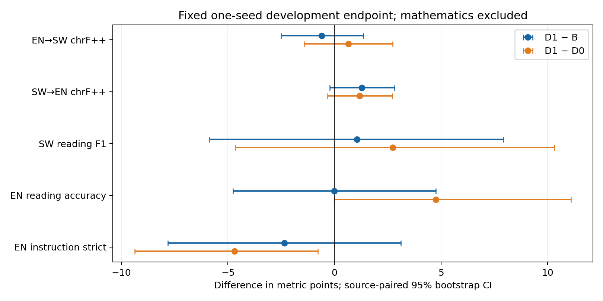
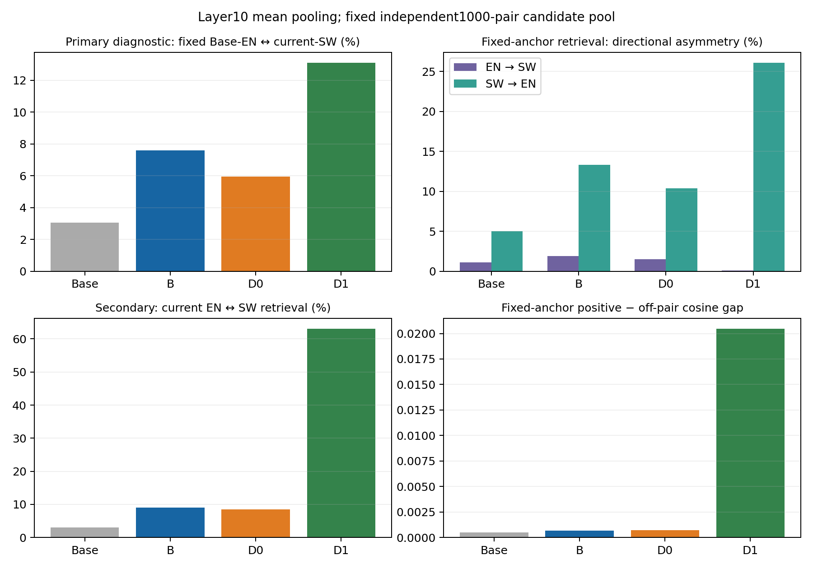

# 增强InfoNCE的最终短预算结果

状态：4293步D1、冻结终点评测、独立1000对表示诊断及原始服务器产物核验全部完成。固定系数21.79455956，单seed42；数学未纳入，正式测试未运行。

## 可直接汇报的三句话

1. 原InfoNCE信号确实弱：16个预定训练batch的辅助/主梯度范数比中位数由0.03245%提升至7.071%，与翻译CE校准量级一致；实际AdamW/BF16副本更新检查也确认了可辨认影响。
2. 独立当前EN↔SW双向检索由D0的8.45%升至D1的63.00%；固定Base英语锚点的双向平均检索：B=7.60%，D0=5.95%，D1=13.10%；下游结果需独立判断。
3. 本轮未通过全部预定门槛，保持停止这一固定原型的决定；不追加系数或层位扫描。

## 同协议开发结果

|模型|EN→SW chrF++|SW→EN chrF++|SW阅读F1|EN阅读内容%|EN指令strict%|
|---|---:|---:|---:|---:|---:|
|Base|18.088|16.949|2.206|84.127|23.438|
|B|27.621|29.457|19.235|79.365|13.281|
|D0|26.359|29.562|17.546|74.603|15.625|
|D1|27.024|30.745|20.288|79.365|10.938|

阅读是KenSwQuAD64与RACE有效63题；翻译为FLORES原始dev128来源组双向；指令为训练来源128条strict代理。不是正式测试。旧v1/POSTHOC/v2表保持原样，本表只组合事先冻结且任务内协议一致的缓存与新D1终点。

|D1 − B|差值|来源配对95%区间|
|---|---:|---:|
|EN→SW chrF++|-0.597|[-2.498, +1.350]|
|SW→EN chrF++|+1.288|[-0.226, +2.814]|
|SW阅读 F1|+1.053|[-5.869, +7.923]|
|EN阅读内容正确率|+0.000|[-4.762, +4.762]|
|EN指令 prompt strict|-2.344|[-7.812, +3.125]|

## 表示是否增强

|模型|固定Base EN→SW检索%|SW→固定Base EN检索%|双向平均%|正例余弦|正负余弦差|
|---|---:|---:|---:|---:|---:|
|Base|1.100|5.000|3.050|0.995912|0.00048454|
|B|1.900|13.300|7.600|0.996124|0.00067879|
|D0|1.500|10.400|5.950|0.995565|0.00070624|
|D1|0.100|26.100|13.100|-0.027860|0.02044795|

固定锚点双向平均通过预定门槛，但方向不对称：D1的EN→SW为0.1%，SW→EN为26.1%。正例绝对余弦由约0.996降为−0.028；正负差增大不等于表示绝对更接近。

|模型|当前EN→SW检索%|当前SW→EN检索%|当前双向平均%|当前正例余弦|SW归一化表示方差迹|
|---|---:|---:|---:|---:|---:|
|Base|1.100|5.000|3.050|0.995912|0.002226|
|B|2.900|15.300|9.100|0.996855|0.002266|
|D0|2.400|14.500|8.450|0.996366|0.002541|
|D1|64.800|61.200|63.000|0.589747|0.888594|

当前模型两种语言的独立检索由D0的8.45%升为D1的63.00%，两个方向都改善。因此不能再把负下游结果简单归因为“完全没有对齐信号”。同时，当前英语表示也发生改变，固定Base锚点不等于固定当前模型英语表示或功能。这是预定的次要诊断，不替换原主要任务和通过条件。

D1−D0检索百分点：+7.15000000，配对95%区间[+5.40000000, +8.90000000]。

D1−D0正负余弦差：+0.01974171，配对95%区间[+0.01711085, +0.02243925]。

固定候选库中按来源配对重采样正确性与余弦差，不在bootstrap里重建含重复候选的检索库。训练损失下降不替代这些独立诊断，也不替代任务指标。

## 冻结判定

|门槛|通过|
|---|---|
|independent_alignment|是|
|ENtoSW_primary|否／证据不足|
|SWreading_noninferiority|否／证据不足|
|reverse_translation_noninferiority|是|
|ENreading_noninferiority|否／证据不足|
|ENinstruction_noninferiority|否／证据不足|

判定依据见[MANDATORY_DECISION.json](MANDATORY_DECISION.json)与[原冻结协议](PROTOCOL_FROZEN.json)。区间宽导致非劣检验未通过，不等于证明真实损伤；反之，表示改善也不保证功能收益。英语保持仅覆盖这些开发任务相对B的表现，不能称全面保持。

## 算法、数据和数值身份

B是同池翻译CE0.1，D0是原Align-D/InfoNCE0.1，D1只把InfoNCE辅助反向系数改为一次性训练侧校准值。三者均为原Dense轨BF16权重/BF16动量。它们不是旧Sparse-D，也不是另一个新建的FP32动量S-All/S-Attn/S-MLP轨道，不能跨轨排名。

主训练：同一Base、相同4293步数据前缀、1,536,351主输入/599,469监督Token、完整42465步学习率日程前缀。层10、内容均值、Base英语bank2000、温度0.07、每4步8对、microbatch4不变。16个batch的固定系数只匹配Base处范数比中位数，不能声称整个训练过程始终匹配CE梯度强度。

B/D0代码与原始中间/终点状态逐项核验复用；D1全部4293步的LR和主/辅助Token计数与D0逐步一致。双状态副本检查显示实际更新差异增强约30/47倍；真实8步恢复逐位一致。此有限数值证据不能代表整条轨迹每步都同样有效。详见[校准](CALIBRATION_DONE.json)、[副本更新](NUMERIC_CHECK_DONE.json)、[恢复](TECHNICAL_PARITY_DONE.json)、[服务器验核](COMPLETION_VERIFIED.json)。

B/D0/D1共享配对访问次数，但B辅助输入1,735,058 Token、监督472,665；D0/D1辅助SW内容输入290,693 Token，固定英语缓存另计且本轮复用。数据曝光与前后向成本不相等，不能把梯度范数匹配称为所有计算或监督匹配。

平行训练2000对、开发500对与独立诊断1000对的原始文件哈希和来源去重组隔离另行复核。继承的数据质量审查主要由模型辅助与助手复核完成，未获得独立SW母语金标准；近重复过滤也不能证明完全语义去污染。此限制适用于B/D0/D1共同数据池。

每模型生成512条，其中已知一题英语源数据结构错误在D1出分前冻结不计分，保留全部64条阅读输出及原批次。数学评分失效，因此无数学分数或方法排名。SW阅读whole-answer F1仍受答案长度影响；截断、重复、语言标签、内容提取状态分别保留于[完整聚合表](DOWNSTREAM_COMPARISON.json)。没有根据新排名修改解析器。

## 成本和复现

本轮分阶段GPU时间合计约 **1.9535 GPU小时**，工作进程GPU上下文时间合计1.9563小时；首个空日志启动缺少GPU上下文凭证，将其到有效worker启动的整段时间保守计入后，上界1.9972小时，仍在6.75上限内。其中D1训练1.2934小时。物理显存30秒采样峰值21977 MiB，训练日志另有分段采样。见[COSTS.json](COSTS.json)。

原四卡约束在本轮进行中获用户明确授权临时改为使用所有经核实空闲GPU；仅替换本任务CPU监督器/资源获取包装，不改变训练数值代码、全局队列默认或其他任务。见[资源变更](RESOURCE_EXCEPTION.json)。

科学实现、协议、模型/数据/缓存哈希见JSON及[代码目录](code)。两份科学检查点、完整优化器/调度/RNG、TensorBoard、逐题文本留在服务器。公开仅聚合与可审阅代码；原始路径在运行配置中保留，不上传被拒绝的数据历史。此单seed开发筛查无正式测试结论，也不确认表示对齐的原创性或普遍无效。
