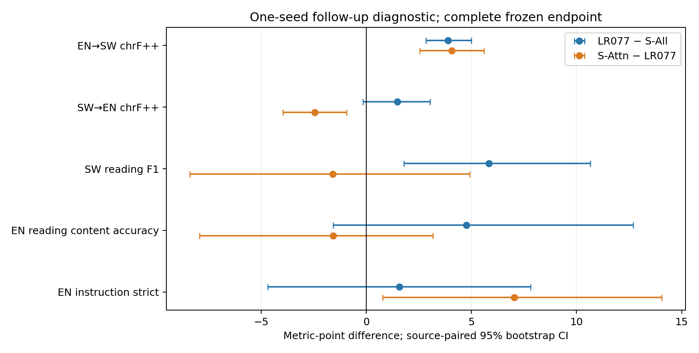
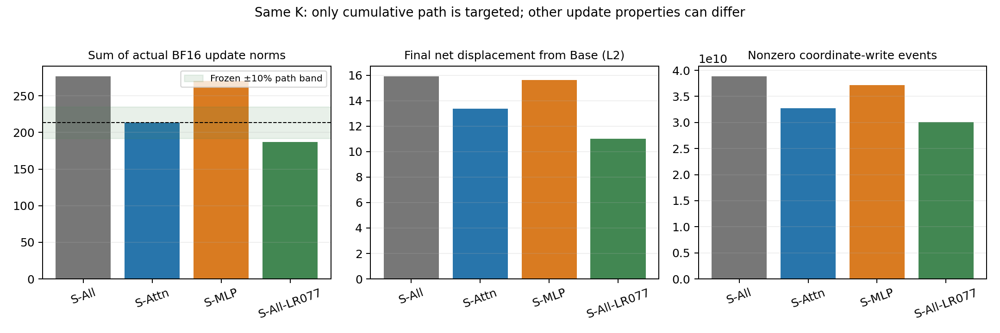

# S-All-LR077：降低学习率是否解释Attention优势

状态：唯一新增4293步训练、512条冻结端点生成（511条有效评分）、两个完整可恢复检查点及原始服务器核验全部完成。未追加学习率、seed、子空间或正式测试；数学未纳入。

[五个问题的直接回答](INTERPRETATION_ZH.md) · [固定案例复核](CASE_REVIEW_ZH.md)

## 可以直接汇报的结果

1. 累计实际BF16更新路径为 **186.937635**，S-Attn参考值为213.379786；比值0.8761，预定范围[192.0418074,234.7177646]，**未匹配，只能称降低学习率对照**。
2. 相对原S-All，EN→SW变化+3.888 chrF++，95%区间[+2.827,+5.002]；英语阅读+4.762点，英语指令strict +1.562点，完整区间见下表。
3. Attention相对新对照的预定联合门槛 **未通过**；更新强度混杂仍未排除，不能将剩余差距纯归因于模块位置。

## 同协议开发结果

|模型|EN→SW chrF++|SW→EN chrF++|SW阅读F1|EN阅读内容%|EN指令strict%|
|---|---:|---:|---:|---:|---:|
|Base|18.088|16.949|2.206|84.127|23.438|
|S-All|15.064|26.071|11.454|79.365|16.406|
|S-Attn|23.021|25.099|15.694|82.540|25.000|
|S-MLP|15.318|27.802|19.373|82.540|19.531|
|S-All-LR077|18.952|27.546|17.290|84.127|17.969|

SW阅读64题；英语阅读64条均保留生成，沿用出分前排除的1道错误源题，评分有效63题；翻译各128个来源组；英语指令strict代理128条。内容与格式分报。它们是原冻结开发材料，不是正式Belebele/IFEval/GSM8K测试。旧三组和Base使用核验缓存，新模型完整生成，没有减少分母或按排名修改解析器。

|指标|LR077 − 原S-All：差值 [95%区间]|S-Attn − LR077：差值 [95%区间]|
|---|---:|---:|
|EN→SW chrF++|+3.888 [+2.827,+5.002]|+4.070 [+2.535,+5.603]|
|SW→EN chrF++|+1.475 [-0.166,+3.022]|-2.447 [-3.960,-0.930]|
|SW阅读F1|+5.836 [+1.792,+10.650]|-1.595 [-8.394,+4.908]|
|EN阅读内容%|+4.762 [-1.587,+12.698]|-1.587 [-7.937,+3.175]|
|EN指令strict%|+1.562 [-4.688,+7.812]|+7.031 [+0.781,+14.062]|

配对区间使用与上轮逐字节相同的10000次来源分组bootstrap，seed42；chrF++按语料统计重算，不平均逐句分数。没有混合任务均分或中间checkpoint选优。

## Attention哪些优势仍有证据

|指标|原S-Attn−S-All点估计|新S-Attn−LR077点估计|新配对区间的解释|
|---|---:|---:|---|
|EN→SW chrF++|+7.958|+4.070|区间支持Attention更高|
|SW→EN chrF++|-0.972|-2.447|区间支持Attention更低|
|SW阅读F1|+4.241|-1.595|区间跨越或触及0，差异不确定|
|EN阅读内容%|+3.175|-1.587|区间跨越或触及0，差异不确定|
|EN指令strict%|+8.594|+7.031|区间支持Attention更高|

这是后续单seed诊断，旧差距与新差距的变化先作描述，不把“不显著”解释为等效或优势消失。

## 更新强度与模块统计

|模型|累计实际更新路径|最终Base净位移L2|累计非零写回事件|mask选中并集|
|---|---:|---:|---:|---:|
|S-All|276.602149|15.911110|38851396390|990515518|
|S-Attn|213.379786|13.375659|32744528840|153275924|
|S-MLP|270.168397|15.637091|37206634254|932675057|
|S-All-LR077|186.937635|10.998147|30092471131|968455517|

LR077最终净位移与S-Attn之比0.8223。±10%只约束累计全局路径；不是每步范数、净位移、参数支持、动量或各模块路径的匹配。mask并集是选中过的位置（包括LR0及舍入后不变的位置），不是实际写回过的唯一坐标数。

|LR077模块|累计模块位移范数之和|最终模块净位移L2|最终变化坐标数|
|---|---:|---:|---:|
|Attention|65.194488|3.774144|33911593|
|MLP|175.154701|10.330300|301347965|

模块路径范数不能简单相加当作全局路径；完整逐步统计和两组逐题对照保留在服务器。

## 语言、重复、截断与案例

|EN→SW模型|检测为SW|检测为英语|截断|平均重复4gram比例|
|---|---:|---:|---:|---:|
|S-All|1/128|127/128|0/128|0.000000|
|S-All-LR077|47/128|81/128|0/128|0.000810|
|S-Attn|121/128|6/128|6/128|0.039987|

语言标签是同一检测器的诊断，不是正确翻译率。chrF++与输出SW比例不能单独证明语义翻译能力。固定取冻结题序最先3道EN→SW作示例，不按分数挑题；完整三模型回答保存在私有QUALITATIVE_CASES.json，公开仅ID和聚合。助手复核不作为独立母语人工金标。

## 冻结判定与下一阶段

|预定条件|通过|
|---|---|
|累计路径在S-Attn±10%|否|
|ENtoSW_learning_close|是|
|SWtoEN_learning_close|否／证据不足|
|SWreading_learning_close|否／证据不足|
|ENreading_retention_better|否／证据不足|
|ENinstruction_noninferior|是|

阈值沿用上轮：S-Attn−LR077的EN→SW/SW→EN区间下界各≥−1，SW阅读≥−2，英语阅读>0，英语指令≥−2。条件未通过时，区分明确劣势与区间过宽；保持问题只覆盖这些代理任务。

若路径未匹配，本轮不足以区分强度与位置；若匹配且仍有局部差距，说明该seed下单一总路径指标不能解释全部差距，但仍不能确认纯模块因果效应。只有路径接近且预定联合门槛通过，才有条件讨论下一步模块验证；本轮不自动启动任何新增实验。见[冻结判定](MANDATORY_DECISION.json)。

## 身份、数值和恢复核验

从同一Base、seed42、相同4293步数据流训练；1,536,351主输入/599,469监督Token，长度2048、有效batch2、BF16权重/FP32 Adam动量、每步77,070,336个名额；所有196矩阵均计算梯度并沿用clip=1，只有原S-All配额位置写回，embedding/head/Norm/bias冻结。mask按原规则自然更新，没有复制旧后续mask。

engine唯一算术改动为原完整学习率函数乘0.7714，峰值3.857e-5，warmup2124、完整日程42465和4293结束位置不变。完整42466个调度取值在训练前核验；正式4293步LR、Token和K逐步核验，前两步主损失与裁剪前梯度范数与旧S-All逐位一致。

原三组六份正式检查点与原始缓存训练前重验；新最长样本2030/2007 Token预检及4→8保存恢复的全部权重、FP32动量、mask/并集与RNG逐位一致。新2146/4293检查点完整哈希及optimizer/scheduler/RNG/预算状态再核验。详见[原产物复核](REFERENCE_REUSE_VERIFIED.json)、[实现身份](IMPLEMENTATION_IDENTITY.json)、[真实预检](TECHNICAL_DONE.json)、[完成验核](COMPLETION_VERIFIED.json)。

## 成本和复现

本轮工作进程GPU上下文合计 **1.9865小时**，上限3；预检0.0396、训练1.4187、端点评测0.5272 GPU小时。新训练物理显存采样峰值23453 MiB。时间包括持有GPU时的加载/保存/哈希，不等于纯GPU计算时间。见[COSTS.json](COSTS.json)。

统一检查点入口`/data0/users/lixiaoyang/models/checkpoint/module_lr077_20261023`，实际位置`/data1/lixiaoyang/module_lr077_20261023`；日志`/data0/users/lixiaoyang/logs/module_lr077_20261023`，TensorBoard和可恢复状态齐全。原正式训练检查点、原始数据和日志均保留；已验收冗余4/8步技术载荷清理另有逐文件哈希凭证，不作为本轮科学训练。

公开仅代码、配置、聚合指标、图和核验凭证；题文、完整回答和权重留服务器。依赖本机原冻结common代码和数据，不应把公开快照理解为包含所有数据的独立运行包。历史D2及Dense对齐轨与本轮分开，不跨轨排名。
