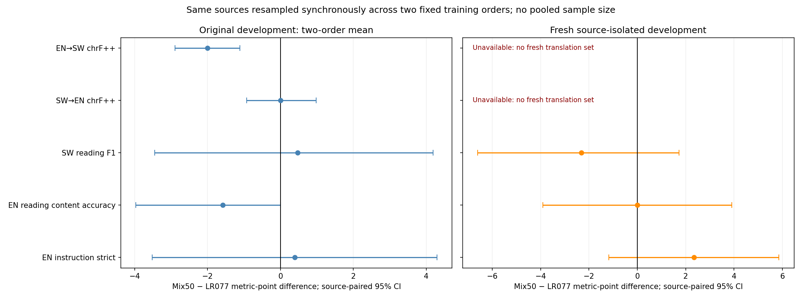
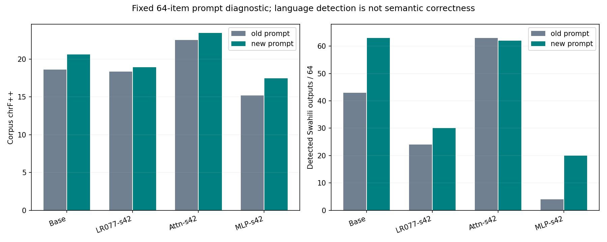

# 模块预算分配：S-Mix50与两种训练顺序

**状态：四份4293步短训、提示诊断、可用新开发任务及旧开发追踪完成；原始状态与结果核验通过。**

[一页结论](INTERPRETATION_ZH.md) · [完整成本与Token账本](COST_AND_TOKENS.json) · [排除口径澄清](AUDIT_CLARIFICATION.json) · [故障恢复记录](RECOVERY_AUDIT.json)

主要候选将每步77,070,336个元素名额平均分给Attention与MLP，分别38,535,168；其余配置与同顺序LR077一致。Attention-only沿用原5e-5配方，和Mix50比较同时涉及学习率与配额，不能解释为仅改变模块位置。

**新翻译确认集缺口：**按共同原文档排除历史Igbo/SW开发／评测池及训练侧曝光后，仅剩1个未使用FLORES开发文档，不足128。没有使用正式测试或替换题源；新确认仅覆盖SW阅读64、EN阅读64、英语指令代理128。原定EN→SW两顺序升级标准不可完整验收。已有旧题结果也未显示Mix50稳定收益，建议停止当前固定配方的扩展。

**预定决定：** Evidence insufficient for original progression rule: fresh source-isolated translation confirmation unavailable

## 分开的开发结果

### 旧开发追踪

|模型|EN→SW chrF++|SW→EN chrF++|SW阅读F1|EN阅读%|EN指令strict%|
|---|---:|---:|---:|---:|---:|
|Base|18.088|16.949|2.206|84.127|23.438|
|LR077-s42|18.952|27.546|17.290|84.127|17.969|
|Attn-s42|23.021|25.099|15.694|82.540|25.000|
|LR077-s43|25.164|27.976|7.191|84.127|17.188|
|Attn-s43|24.058|26.201|8.326|79.365|16.406|
|Mix50-s42|15.445|27.710|15.260|80.952|21.094|
|Mix50-s43|24.668|27.815|10.170|84.127|14.844|

|同顺序比较|任务|差值|来源配对95%区间|
|---|---|---:|---|
|Mix50-s42-minus-LR077-s42|EN→SW|-3.507|[-4.600,-2.471]|
|Mix50-s42-minus-LR077-s42|SW→EN|+0.164|[-1.374,+1.795]|
|Mix50-s42-minus-LR077-s42|SW阅读F1|-2.030|[-8.918,+4.068]|
|Mix50-s42-minus-LR077-s42|EN阅读%|-3.175|[-7.937,+0.000]|
|Mix50-s42-minus-LR077-s42|EN指令strict%|+3.125|[-3.125,+9.375]|
|Attn-s42-minus-LR077-s42|EN→SW|+4.070|[+2.535,+5.603]|
|Attn-s42-minus-LR077-s42|SW→EN|-2.447|[-3.960,-0.930]|
|Attn-s42-minus-LR077-s42|SW阅读F1|-1.595|[-8.394,+4.908]|
|Attn-s42-minus-LR077-s42|EN阅读%|-1.587|[-7.937,+3.175]|
|Attn-s42-minus-LR077-s42|EN指令strict%|+7.031|[+0.781,+14.062]|
|Mix50-s43-minus-LR077-s43|EN→SW|-0.496|[-1.709,+0.747]|
|Mix50-s43-minus-LR077-s43|SW→EN|-0.161|[-1.055,+0.776]|
|Mix50-s43-minus-LR077-s43|SW阅读F1|+2.979|[+0.067,+6.097]|
|Mix50-s43-minus-LR077-s43|EN阅读%|+0.000|[+0.000,+0.000]|
|Mix50-s43-minus-LR077-s43|EN指令strict%|-2.344|[-7.031,+2.344]|
|Attn-s43-minus-LR077-s43|EN→SW|-1.107|[-2.284,+0.004]|
|Attn-s43-minus-LR077-s43|SW→EN|-1.775|[-3.132,-0.448]|
|Attn-s43-minus-LR077-s43|SW阅读F1|+1.135|[-2.083,+4.788]|
|Attn-s43-minus-LR077-s43|EN阅读%|-4.762|[-11.111,+1.587]|
|Attn-s43-minus-LR077-s43|EN指令strict%|-0.781|[-5.469,+4.688]|

两顺序平均：按同一批来源同步重采样，再平均两套固定模型的差值；未将样本量翻倍。

|任务|两顺序平均Mix50−LR077|配对95%区间|
|---|---:|---|
|EN→SW|-2.002|[-2.896,-1.118]|
|SW→EN|+0.001|[-0.928,+0.975]|
|SW阅读F1|+0.475|[-3.453,+4.191]|
|EN阅读%|-1.587|[-3.968,+0.000]|
|EN指令strict%|+0.391|[-3.516,+4.297]|

相对Base的英语损伤另列在OLD_RESULTS.json的English_vs_Base字段；超过LR077不代表保持解决。

### 新来源隔离开发（缺少翻译）

|模型|EN→SW chrF++|SW→EN chrF++|SW阅读F1|EN阅读%|EN指令strict%|
|---|---:|---:|---:|---:|---:|
|Base|缺口|缺口|4.154|89.062|21.875|
|LR077-s42|缺口|缺口|23.102|79.688|21.875|
|Attn-s42|缺口|缺口|17.945|85.938|25.000|
|LR077-s43|缺口|缺口|8.007|85.938|13.281|
|Attn-s43|缺口|缺口|8.702|82.812|18.750|
|Mix50-s42|缺口|缺口|18.032|81.250|23.438|
|Mix50-s43|缺口|缺口|8.453|84.375|16.406|

|同顺序比较|任务|差值|来源配对95%区间|
|---|---|---:|---|
|Mix50-s42-minus-LR077-s42|SW阅读F1|-5.070|[-12.733,+2.162]|
|Mix50-s42-minus-LR077-s42|EN阅读%|+1.562|[-4.688,+7.812]|
|Mix50-s42-minus-LR077-s42|EN指令strict%|+1.562|[-3.906,+7.031]|
|Attn-s42-minus-LR077-s42|SW阅读F1|-5.157|[-14.096,+3.122]|
|Attn-s42-minus-LR077-s42|EN阅读%|+6.250|[-1.562,+15.625]|
|Attn-s42-minus-LR077-s42|EN指令strict%|+3.125|[-3.906,+9.375]|
|Mix50-s43-minus-LR077-s43|SW阅读F1|+0.446|[-3.799,+3.680]|
|Mix50-s43-minus-LR077-s43|EN阅读%|-1.562|[-7.812,+4.688]|
|Mix50-s43-minus-LR077-s43|EN指令strict%|+3.125|[+0.000,+7.031]|
|Attn-s43-minus-LR077-s43|SW阅读F1|+0.695|[-4.882,+5.810]|
|Attn-s43-minus-LR077-s43|EN阅读%|-3.125|[-10.938,+4.688]|
|Attn-s43-minus-LR077-s43|EN指令strict%|+5.469|[+0.781,+10.938]|

两顺序平均：按同一批来源同步重采样，再平均两套固定模型的差值；未将样本量翻倍。

|任务|两顺序平均Mix50−LR077|配对95%区间|
|---|---:|---|
|SW阅读F1|-2.312|[-6.600,+1.730]|
|EN阅读%|+0.000|[-3.906,+3.906]|
|EN指令strict%|+2.344|[-1.172,+5.859]|

相对Base的英语损伤另列在CONFIRMATION_RESULTS.json的English_vs_Base字段；超过LR077不代表保持解决。

## 单一加强提示诊断

从原128题以random.Random(42)抽取64题；四模型共256条新回答，旧提示复用对应缓存。原提示语言名称、chat template、源文本边界及截断检查未发现确定实现错误。不按模型输出筛子集，不更换正式主提示。

|模型|原chrF++|新chrF++|原/新检测SW|原/新截断|
|---|---:|---:|---:|---:|
|Base|18.608|20.614|43/63|14/4|
|LR077-s42|18.356|18.901|24/30|0/0|
|Attn-s42|22.530|23.440|63/62|3/1|
|MLP-s42|15.188|17.447|4/20|0/1|

Attention−LR077差距的提示变化（新−旧）为+0.365，来源配对95%区间[-1.987,+2.820]。它是提示敏感性诊断，不是语言控制与内容质量的完整因果分解。所有语言、重复、截断指标保存在PROMPT_SENSITIVITY.json。

新提示同时改为英语指令并加入输出限制，不能区分指令语言与明确程度各自的作用。Mix50没有参与本项提示诊断。

## 实际更新、数值与成本

|模型|累计实际BF16路径|最终Base净位移L2|非零写回事件|物理显存峰值MiB|
|---|---:|---:|---:|---:|
|LR077-s43|186.861096|10.985976|30102028322|22303|
|Attn-s43|213.229171|13.359026|32719666730|17763|
|Mix50-s42|182.150846|10.744961|30235474297|23659|
|Mix50-s43|181.712412|10.715484|30208445644|22395|

整轮持卡上下文成本9.8535 GPU小时，上限16，包含预检、加载、保存、失败尝试与全部新评测。逐阶段成本与输入/监督/生成Token在COMPLETION_VERIFIED.json及运行日志。

每份均有2146/4293完整checkpoint，权重、FP32 Adam动量、scheduler、RNG和配额可恢复。每配方最长真实batch预检及4→8保存恢复逐位核验；正式每步LR、K、模块名额、顺序与Token核验。优化器继承原实现且哈希一致。

数据：Aya SW80%＋双向翻译各10%的同一冻结前缀，每份1,536,351主输入/599,469监督Token。seed43只打乱原4293个两样本更新块；同seed各方法完全同序。两种训练顺序不代表训练随机性的总体分布。

检查点统一入口：`/srv/multilingual/models/checkpoint/module_mix50_20261023`，实体在`/srv/multilingual/checkpoint-storage/module_mix50_20261023`；日志和TensorBoard：`/srv/multilingual/logs/module_mix50_20261023`。

## 解释边界与停止条件

本轮仅检验简单模块配额分配，未建立算法创新性；没有强行匹配实际更新路径，不能声称收益独立于更新强度。旧新开发分表，不合并扩大样本量。数学、正式测试、LoRA、表示对齐、子空间、首尾层、第二语言均未运行。

新翻译确认缺失意味着本轮不能完整判定原升级标准；无论旧题得分如何，都不自动追加比例、学习率、seed或训练长度。来源ID与词面近重复检查不能证明完全语义去污染；阅读/指令为训练侧代理，不是正式Belebele/IFEval。

公开保留代码、配置、聚合与核验，题文、逐条回答及权重留服务器。私有逐题比较为work/module_mix50_v1/PAIRED_ITEMS.jsonl。

## 故障、公开范围与解释

独立Base评测第一次启动时，原worker的argparse参数转发在CUDA初始化前拒绝--model，未加载模型、未产生回答。独立recovery_worker/recovery_coordinate修复CLI转发并通过CPU回归；原冻结训练、模型、题目、评分及生成代码保持不变，失败日志和原协调器退出记录保留。其余7项既有模型评测完成接续，没有新增科学训练；该失败GPU成本为0，全部实际持卡上下文计入9.8535小时。

历史开发池曝光不等于训练泄漏。既有正式输入仅用于构建去重黑名单；没有新增正式测试预测、分数、保护或模型选择。冻结manifest中的formal_sentence_text_read=false只指未加载FLORES归档中的正式句子文件，不能理解为从未读取任何既有正式输入文本；范围澄清另列AUDIT_CLARIFICATION.json，原始manifest未覆盖。

公开代码为脱敏审阅副本，依赖服务器已有冻结common工具、数据和私有清单；代码需按实际项目目录部署并配置私有路径，不是独立下载即跑的软件包。公开副本与服务器原码的哈希及路径替换说明见PUBLICATION_SCOPE.json。
