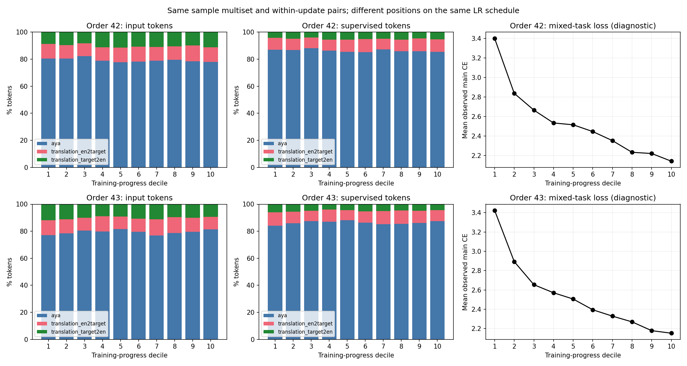
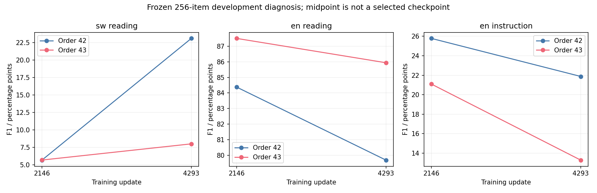

# LR077训练顺序敏感性诊断（2026-10-25）

**两份中间checkpoint评测及CPU核查完成；不追加训练或选取最佳checkpoint。**

本轮只诊断LR077的两个训练顺序，不继续表示对齐、Attention-only优先或Mix50扩展。上限512条新回答、2 GPU小时，本账号所有任务合计最多四卡。

## 1. 实现与数据身份核查

实际读取了服务器训练数据、8586次样本呈现、两组4293条逐步日志，以及2146/4293步共四个完整checkpoint。权重及状态文件均重新计算哈希，对照原RECOVERABLE凭证；检查scheduler、step、counts、RNG存在性和优化器张量类型。历史真实恢复核验凭证保留；本轮没有执行训练恢复或新更新。

- 两组样本与重复次数一致，实际为8586个不同源行；每个两样本更新块内顺序保持一致。
- 主输入均为1,536,351 Token，监督均为599,469 Token；每步计数、学习率及K逐项与来源核对。
- 同一优化器字节实现，BF16权重、FP32动量、每20步刷新mask，学习率峰值3.857e-5，同一42465步日程前缀、warmup2124。
- 两组配置均未从中间状态恢复；中间保存后的历史原地加载核验也有凭证。未发现这次审查范围内的数据丢失、计数、学习率或恢复错误。
- 现有原始行不提供未截断文本；这里只能查长度达到2048的代理，本前缀为0，不能反推上游不存在预处理截断。

## 2. 是否存在任务聚集

|顺序|Aya输入占比十段范围|EN→SW输入占比范围|SW→EN输入占比范围|同任务对最长连续块|混合主CE全程均值|
|---|---:|---:|---:|---:|---:|
|42|77.82–82.36%|9.49–11.53%|8.16–11.34%|8|2.5345|
|43|76.89–81.56%|9.31–12.00%|9.03–11.81%|6|2.5379|

十段组成没有显示某个任务集中占据训练前半或末尾的严重分块。两顺序都接近Aya80%＋双向翻译各10%的输入口径；监督Token则以Aya约86%为主，输入配比和监督配比不能混称。

warmup后的监督量有变化，例如SW→EN从15,296变为14,581 Token。若用学习率×监督Token求和作描述，43相对42的Aya约+2.10%、EN→SW约+0.20%、SW→EN约−4.27%。这些是描述性代理，不是实际梯度权重或因果证据；原目标先按样本算CE再平均，不能用Token加权统计替代目标函数。

## 3. SW阅读端点：F1下降伴随什么

|顺序|F1|严格词面完全一致/64|平均生成Token|检测为SW/64|截断/64|零词面重叠/64|
|---|---:|---:|---:|---:|---:|---:|
|42|23.102|10|26.45|44|4|42|
|43|8.007|1|42.06|60|4|45|

第二顺序回答更长，但截断数相同；被检测为SW的数量更多。平均词面precision从0.211降到0.057，recall从0.318降到0.247。差距不仅伴随冗长，也伴随参考信息覆盖下降；不能仅解释为语言没切换、截断增加或纯格式损失。

按事先冻结的哈希规则抽16题，模型名显示为A/B。样本中同时见到真实答偏、人物题回答“是/否”、复述问题、循环，以及答案含正确实体却因长答降低F1、Dawa/madawa词形不同可能漏计等情况。此抽查不修改原分；同一助手准备映射并复核，不构成独立完全盲评，也没有SW母语者判定，不能把全部F1变化等同阅读理解变化。

64题中顺序42较高18题、43较高11题、35题持平；仅3题输出文本完全一致。语言检测在极短答案上不可靠，零词面重叠也不自动等于答非所问。

## 4. 中间点与端点：同一冻结256题

|顺序|步数|SW阅读F1|英语阅读内容%|英语指令strict%|
|---|---:|---:|---:|---:|
|42|2146|5.676|84.375|25.781|
|42|4293|23.102|79.688|21.875|
|43|2146|5.688|87.500|21.094|
|43|4293|8.007|85.938|13.281|

SW阅读42−43差距：2146步为-0.011 F1，来源配对95%区间[-5.573, 5.477]；4293步为15.096，区间[5.538, 25.045]。

**读表结论：这两个观测点之间出现了明显分化。** 顺序42的SW阅读从5.676升至23.102（+17.426，配对95%区间[7.905, 27.381]）；顺序43从5.688升至8.007（+2.319，区间[−3.226, 7.794]）。不是“同一模型从23.10跌到8.01”，而是两条训练轨迹在后半段产生了不同的观测结果。中段差距区间较宽，不能因点估计相近就证明两模型能力等价。

中段SW阅读输出均较长：顺序42平均136.33生成Token、29/64条达到上限；顺序43平均122.23 Token、27/64条达到上限。端点分别降到26.45/42.06 Token、均4/64条达到上限。因此，中段低F1还伴随严重的长度与结束行为问题；不能把曲线当作纯阅读理解能力轨迹，或断言端点差距已完全排除评分影响。未改变生成上限或评分。

英语任务也并非全同方向：两组英语阅读点估计均下降，区间都包含0；顺序43的英语指令strict由21.094%降至13.281%（−7.813个百分点，配对95%区间[−13.281, −3.125]）。这些结果只代表对应冻结开发任务，不是全面能力评估。

中间点只用于定位变化阶段，没有用来替换端点或选最佳模型。两点无法给出完整轨迹，也不能证明具体样本或任务导致差异。

## 5. 证据分级与停止决定

**已核实：** 样本曝光相同；学习率与优化器实现符合配置；端点F1差距真实存在于冻结词面评分；输出长度与答案行为不同。

**可检验线索：** 相同总量在学习率不同阶段的任务曝光并不完全相同，且逐步样本/动量/mask会不同。不过十段统计没有揭示足以解释差距的严重任务聚集，不能据此直接启动“均匀任务顺序”新训练。

**暂不能解释：** 哪些具体样本及其顺序、优化器历史或稀疏mask演化造成了最终取舍；多少是功能变化、多少是SW词面评分局限。两个顺序不足以估计训练稳定性总体。本轮不新增梯度/代理探针来无限延长解释。

**决定：** 保持停止当前固定原型扩展。本次不新增训练、扫描参数、选择checkpoint或使用正式测试；若无新的清晰可证伪假设，暂停当前方法原型。开发题可以继续用于开发，不能因此称为全新独立确认；最终确认材料不足与训练泄漏是不同问题。

## 6. 完成范围与成本

评测于2026-10-25完成，最终读表与发布核验于2026-10-26进行。新增回答512/512；GPU持卡上下文成本1.0930/2小时。排队和CPU审计不计GPU小时。所有原始输出、权重、状态和私有来源清单保留在服务器。公开材料仅用聚合统计、审计哈希与图，不发布逐题正文和私有服务器路径。

核查脚本与数据身份、分段统计见DATA_ORDER_AUDIT.json；评分与配对区间见RESULTS.json和SCORES.csv；固定规则见PROTOCOL_FROZEN.json；抽查限制见CASE_REVIEW_ZH.json。
