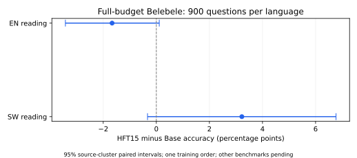

# 首批完整预算benchmark结果：Base与HFT15阅读

本表仅覆盖EN/SW Belebele各900题；其他任务和方法尚未完成，不能据此给出全套方法排名。

|模型|EN阅读正确数/900|EN ACC%|SW阅读正确数/900|SW ACC%|
|---|---:|---:|---:|---:|
|Base|736|81.778|338|37.556|
|HFT15|721|80.111|367|40.778|

|HFT15−Base|差值（百分点）|来源配对95%区间|
|---|---:|---|
|belebele_en|-1.667|[-3.426, +0.111]|
|belebele_sw|+3.222|[-0.331, +6.770]|

同一Qwen2.5-1.5B-Instruct、相同冻结3-shot MCF提示与评分；HFT15为Aya80/10/10完整15,360,935主输入Token终点，整矩阵预算匹配变体，不是原论文HFT50。
HFT15每步名额196,608,000，约占196候选矩阵15.0060024%；本结果不能代替P−U的英语保护效果比较。
区间为10,000次按来源文档配对重采样，反映固定模型题目/来源的不确定性，不代表训练seed总体稳定性。既有暴露benchmark属于补充比较，不称未见最终确认。
历史FineWeb主导D2结果与本轮Aya主导配方分表；不从跨配方分数变化推断算法因果效果。
相同预算的U/P、Dense/SSU以及知识、翻译、指令和数学仍待完整评测；不存在未完成项目补零或用代理指标代替的情况。

