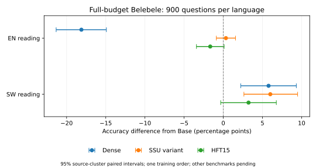

# 完整预算SW基线：已完成阅读benchmark阶段结果

当前仅4个模型完成EN/SW Belebele各900题，其他模型及任务未齐；不是整轮最终表。

|模型|SW正确数/900|SW ACC%|EN正确数/900|EN ACC%|
|---|---:|---:|---:|---:|
|Base|338|37.556|736|81.778|
|Dense FFT|390|43.333|573|63.667|
|SSU-token-weighted-15matched|392|43.556|739|82.111|
|HFT-whole-matrix-15matched|367|40.778|721|80.111|

|比较|SW差值pp [来源配对95%CI]|EN差值pp [来源配对95%CI]|
|---|---|---|
|Dense-Base|+5.778 [+2.227, +9.323]|-18.111 [-21.333, -14.922]|
|Dense-HFT15|+2.556 [-0.773, +5.922]|-16.444 [-19.558, -13.429]|
|Dense-SSU|-0.222 [-3.671, +3.259]|-18.444 [-21.589, -15.246]|
|SSU-Base|+6.000 [+2.632, +9.487]|+0.333 [-0.885, +1.559]|
|SSU-HFT15|+2.778 [+0.223, +5.339]|+2.000 [+0.441, +3.622]|
|HFT15-Base|+3.222 [-0.331, +6.770]|-1.667 [-3.426, +0.111]|
|HFT15-SSU|-2.778 [-5.339, -0.223]|-2.000 [-3.622, -0.441]|

## 配置与证据边界

同一Qwen2.5-1.5B-Instruct；适配端点均为Aya SW80%加双向翻译各10%的完整42,465步、15,360,935主输入Token。相同冻结3-shot MCF阅读协议，使用选择题ACC，不是生成阅读F1。
HFT15为整矩阵15%预算匹配变体，非原论文HFT50；当前SSU按Token加权激活，非参考代码的样本等权版本。HFT15/SSU/U/P共同名额196,608,000，占196候选矩阵15.0060024%，不是全模型15%。
SSU另有128例、29,407输入Token的静态英语激活校准，无CE反向；相同主训练Token不代表相同总曝光或计算。
每项差值使用10,000次按来源文档配对重采样；单训练顺序，区间不代表训练seed总体稳定性，多个比较是探索性而非校正后的整体最优检验。已暴露benchmark属于补充比较，不称全新独立最终确认。
知识、双向完整翻译、指令和数学仍待完成；不能仅凭阅读宣布整体胜出。P−U尚未齐时，不能宣称英语保护在新配方下有效。历史D2与本轮配方及部分评测协议不同，分表报告，不从跨配方分数差推断因果。

## 本阶段的主要发现

Dense FFT相对Base的SW阅读+5.78个百分点（来源配对95%CI[+2.23,+9.32]），EN阅读−18.11个百分点（[-21.33,-14.92]）。SSU变体相对Dense的EN阅读+18.44个百分点（[+15.25,+21.59]）；SW点估计仅高0.22个百分点，差异区间跨0，不能称为严格相等或已证明SW非劣。该比较支持当前阅读任务上的较好取舍线索，不能推广为全部benchmark的整体优势。
